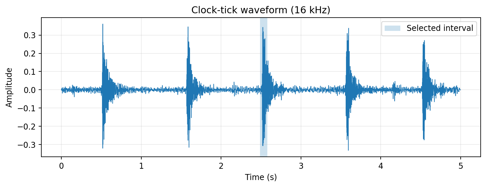
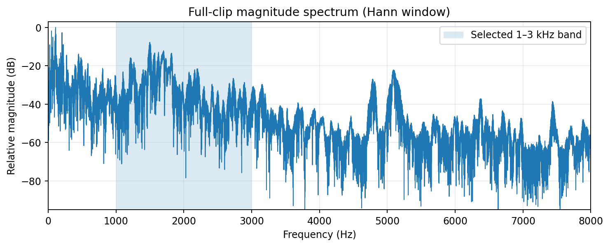
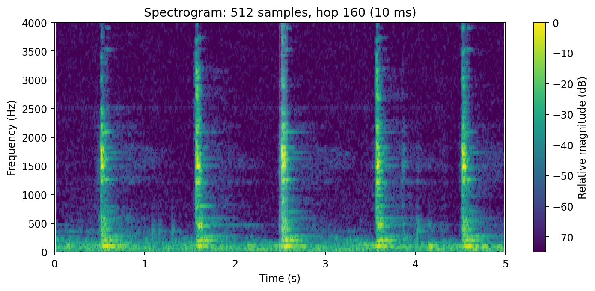
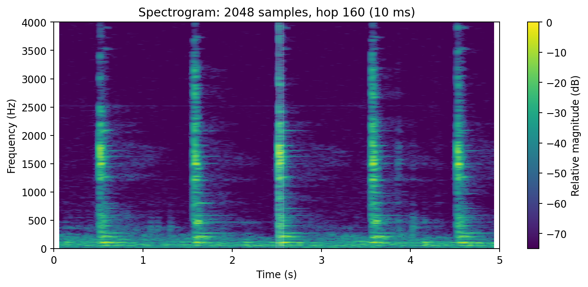

# Option C — Environmental Sound Analysis (Clock Tick)

**Question:** How does spectrogram window length affect the same clock-tick recording?

## Audio and settings

- Supplied ESC-50 audio: `data/1-21934-A-38.wav` (`clock_tick`), 5 seconds, originally 44,100 Hz.
- Resampled to **16,000 Hz**, mono; no new recording.
- Hann-window STFTs: **512** vs **2048** samples, both with **160-sample hop** (10 ms), no FFT zero-padding.
- 512 samples = 32-ms window, 31.25-Hz FFT-bin spacing; 2048 samples = 128-ms window, 7.8125-Hz FFT-bin spacing.

## Results

**Waveform:** a brief event can be examined around **2.49–2.58 s**.

**Spectrum:** the chosen event has notable energy in the **1–3 kHz** region, alongside lower-frequency energy. The full-clip spectrum cannot locate events in time.

**512-sample spectrogram:** sharper localization of short events in time, but coarser frequency-bin spacing.

**2048-sample spectrogram:** finer frequency-bin spacing but temporal smearing over a longer window.

## Conclusion and limitation

**Conclusion:** A 512-sample window is better for seeing short tick timing; 2048 samples provide finer frequency-bin spacing. The recording, sample rate, and hop stay unchanged.

**Limitation:** A fixed-window spectrogram trades time resolution against frequency resolution; analysis of a single recording does not establish how all clocks sound.
