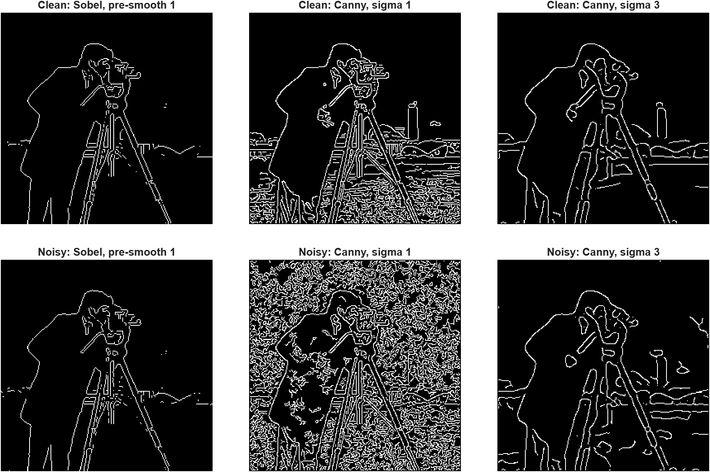
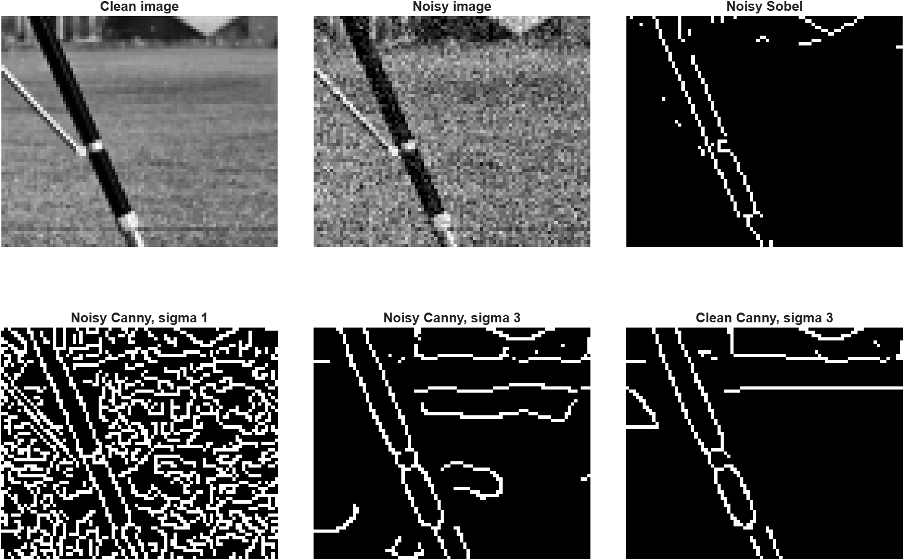

# Option C — Compare Edge Detectors

## Question and data

How do Sobel and Canny edge detectors respond to Gaussian noise?

- Image: `cameraman.tif` (MATLAB sample image, 256 × 256 pixels).
- Noise: `rng(42); imnoise(I,'gaussian',0,0.01)`.
- MATLAB: R2026b Update 2, version 26.2.0.3468271.

## Method and results

Sobel uses `imgaussfilt(I,1)` before edge detection. Canny uses sigma 1 and sigma 3, with MATLAB's automatic thresholds. All detectors are applied to the same clean and noisy images.

*The noisy Canny sigma 1 map contains many extra background edges; the sigma 3 map keeps the stronger outlines and suppresses most of this clutter.*

| Detector | Clean edge pixels | Noisy edge pixels |
|---|---:|---:|
| Sobel (pre-smoothing sigma 1) | 2,099 | 2,024 |
| Canny (sigma 1) | 7,816 | 18,122 |
| Canny (sigma 3) | 2,780 | 3,185 |

Counts were measured using MATLAB `nnz`; the table is saved as [`results/edge_pixel_counts.csv`](results/edge_pixel_counts.csv).

*In the cropped tripod-and-ground region, noisy Canny sigma 1 detects many irregular lines in the textured background. Sigma 3 removes most of these noise-sensitive detections, but some faint details are lost.*

## Conclusion and limitation

For this example, **Canny sigma 3** provides the clearest major outlines in the noisy image. Increasing smoothing reduces noise-driven detections, but can remove small or weak real edges. **Edge-pixel count is not a measure of detection accuracy**, because no ground-truth edge map is available.