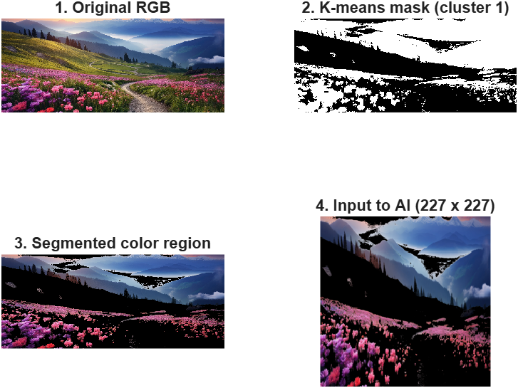
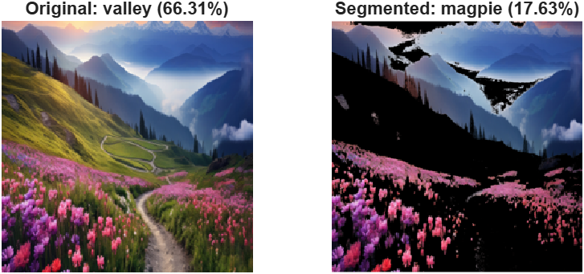

# Hybrid Traditional + AI Pipeline

## 1. Load Image and AI Network

The input is `mountain-landscape.jpg` (1080 × 2560 RGB). A pretrained **SqueezeNet** CNN is used for classification with a 227 × 227 input.

## 2. Traditional Image Segmentation

The image is converted to **L\*a\*b\*** color space. K-means groups pixels into **two color clusters** using the a\* and b\* channels. Cluster **1** (higher mean a\*) is selected, covering **49.93%** of image pixels. Other pixels are set to black before the segmented image is resized for the CNN. The mask identifies color regions rather than a single object.

## 3. AI Classification

The same SqueezeNet model classifies the original image and the segmented image.

## 4. Results and Analysis

| Input | Predicted class | Prediction score |
|---|---|---:|
| Original image | Valley | 66.31% |
| Segmented image | Magpie | 17.63% |

**Observation:** Segmentation changed the predicted class from *valley* to *magpie* and reduced the model's prediction score. The mask removed substantial landscape information, which may have harmed recognition in this test.

**Conclusion:** Traditional segmentation changes the information supplied to the AI model, but it did **not** show an improvement for this image. The original prediction better matches the visible landscape. Prediction scores are not accuracy measurements; no ground-truth accuracy comparison was performed.
