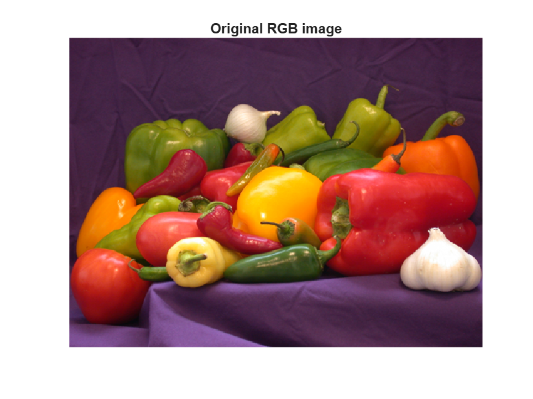
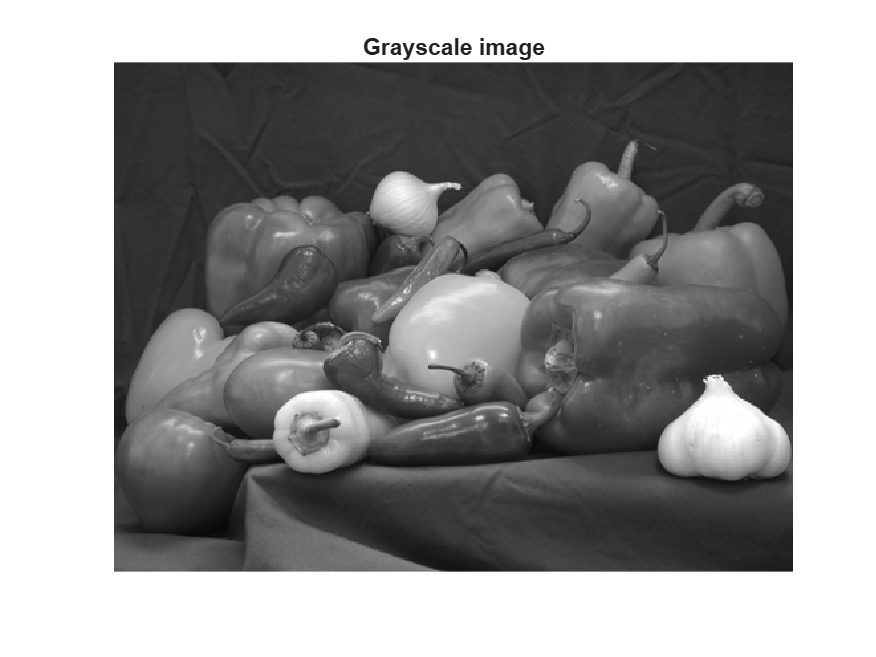
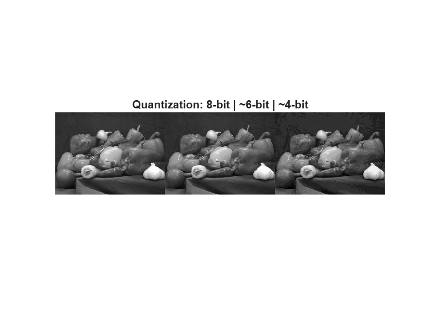
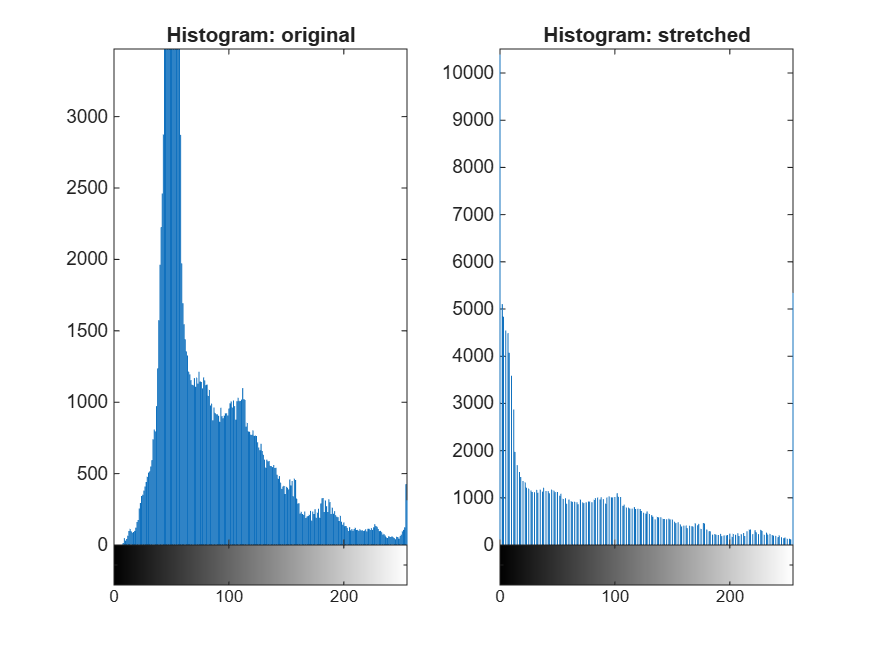
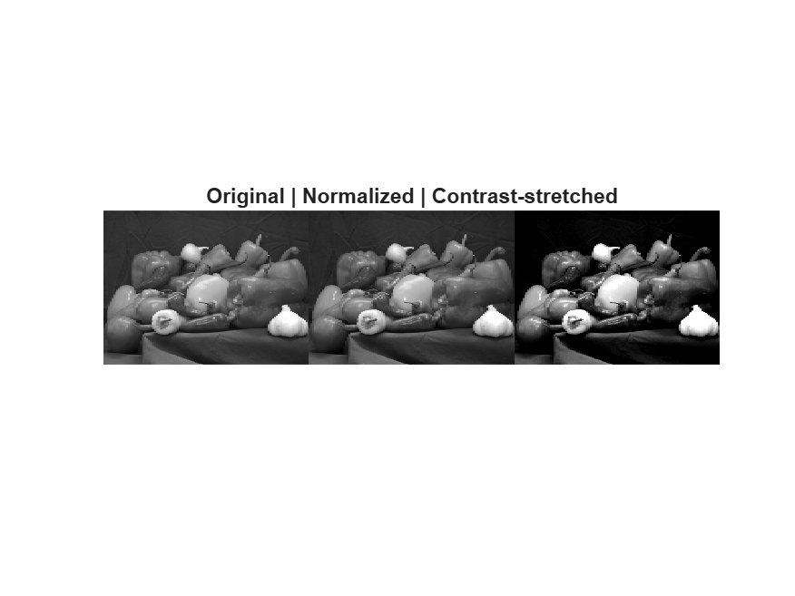
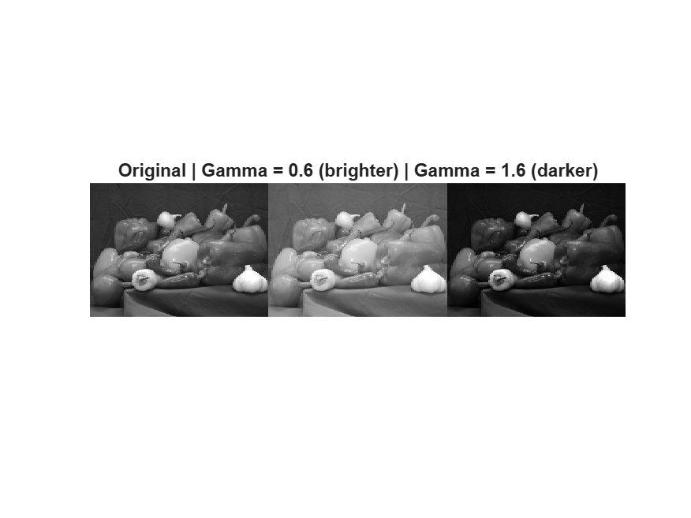
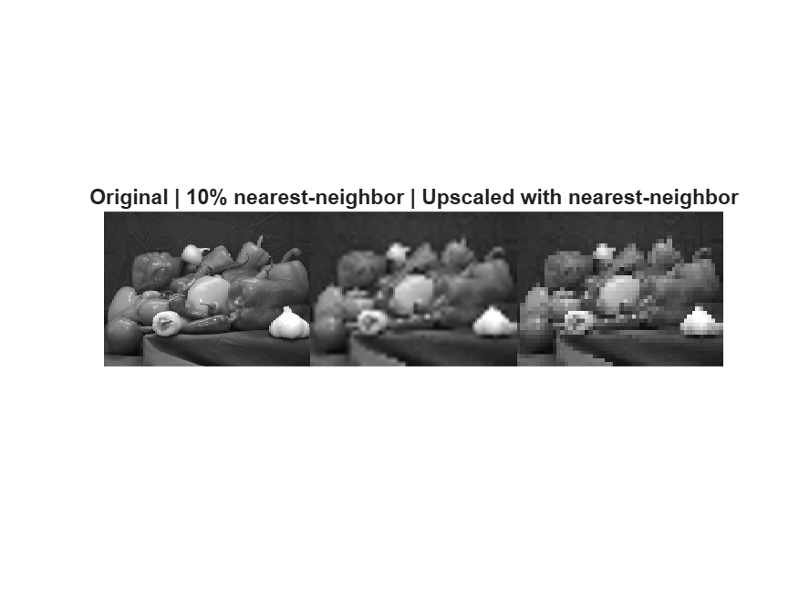

# Lab 1 — Image as a 2D Signal

**Student:** Md Anwar Hossen

## 1. Objective

The objective of this lab is to understand a digital image as a two-dimensional (2D) signal. I used MATLAB to compare grayscale intensity levels, quantization bit depths, image histograms, contrast stretching, gamma correction, and spatial sampling. The screenshots below are results from my MATLAB run, rather than predicted figures.

## 2. MATLAB setup and image used

- **Software:** MATLAB with Image Processing Toolbox
- **Input:** MATLAB sample image `peppers.png` (confirmed by the uploaded original RGB screenshot)
- **Processing:** RGB-to-grayscale conversion using `rgb2gray`, followed by the operations in the lab script
- **MATLAB source file:** [`Lab1_image_2D_signal.m`](Lab1_image_2D_signal.m)

The supplied code originally contained a malformed expression in its `fprintf` statement. I used `min(I(:))` and `max(I(:))` to inspect every grayscale pixel, and added commands to save the figures as PNG files.

**Image dimensions, data class and numerical intensity range:** Not available in the uploaded figures alone; these can be copied from the MATLAB Command Window after running the script. For example:

```matlab
fprintf('Class: %s | Range: [%g, %g] | Size: %d x %d\n', ...
    class(I), double(min(I(:))), double(max(I(:))), size(I,1), size(I,2));
```

## 3. Section 0 — Original image and grayscale conversion





**Observation:** The original picture shows colorful peppers and vegetables. The grayscale conversion removes the hue information while retaining visible differences in brightness and much of the shape and texture information. The lighter vegetables and highlights appear bright gray, and the cloth and shaded objects are darker.

**Explanation:** An RGB image stores three color-channel values for each pixel. A grayscale image uses one intensity value per pixel, so it can be treated as a two-dimensional signal: intensity varies with row and column position.

## 4. Section 1 — Quantization and bit depth



The script compares:

| Version | Maximum gray levels | MATLAB operation | Visual observation |
|---|---:|---|---|
| 8-bit | 256 | `I8 = I;` | Most gradual shading of the three versions |
| Approximately 6-bit | 64 | `floor(double(I)/4)*4` | Very similar to the original at the displayed size; small shade differences |
| Approximately 4-bit | 16 | `floor(double(I)/16)*16` | More visibly stepped tones, especially in shadow areas and smooth surfaces |

**Explanation:** Quantization reduces the number of values available to describe a pixel. The step sizes in this experiment are 1, 4, and 16 intensity units, respectively. As the number of levels decreases, nearby brightness values are grouped together. This can produce visible banding or posterization and reduce subtle shading detail.

## 5. Section 2 — Histogram and contrast stretching





The contrast adjustment uses:

```matlab
I_norm = mat2gray(I);
I_stretch = imadjust(I, [0.2 0.8], [0 1]);
```

**Histogram observation:** The original histogram has many pixels in the darker-to-middle intensity levels. After contrast stretching, values are distributed more broadly across the output range, with prominent concentrations near the darkest and brightest ends. These concentrations are consistent with intensity clipping outside the selected input interval.

**Image observation:** The normalized version looks broadly similar to the original. The contrast-stretched version makes bright objects and midtone differences more pronounced, but some background and shadow areas become nearly black, and some highlights become almost white. As a result, contrast improves in some regions while subtle details are lost in clipped regions.

**Explanation:** The chosen `imadjust` operation maps normalized input intensities from 0.2 to 0.8 onto the entire 0-to-1 output range. Within that interval the mapping is linear; outside it, values are clipped. This is different from histogram equalization, and stronger contrast does not necessarily preserve every detail.

## 6. Section 3 — Gamma correction



**Observation:** The gamma-0.6 image is noticeably brighter than the original, particularly in darker and middle-gray regions. The gamma-1.6 version is darker, especially in the cloth and shaded vegetable surfaces. Bright highlights remain more visible than the darkest regions.

**Explanation:** Gamma correction is a nonlinear intensity transformation. Conceptually, normalized intensities are transformed by

\[
I_{\mathrm{out}} = I_{\mathrm{in}}^{\gamma}.
\]

For input intensities between 0 and 1, a gamma value **below 1** raises their displayed intensity, while a value **above 1** lowers it. Thus gamma can modify perceived brightness without using the same piecewise-linear mapping as the contrast-stretching experiment.

## 7. Section 4 — Spatial sampling, resizing and aliasing



The script performs:

```matlab
scale = 0.1;
I_small = imresize(I, scale, 'nearest');
I_back = imresize(I_small, size(I), 'nearest');
```

**Observation:** The 10%-size version contains far less visible fine detail than the original. Enlarging it back to the original dimensions does **not** restore the lost information: vegetables, edges and textures appear blocky or jagged, and small details are difficult to distinguish.

**Explanation:** Reducing both width and height to about 10% retains approximately 1% of the original number of pixels. Downsampling reduces the spatial sampling rate. According to the spatial Nyquist principle, image detail whose frequency exceeds half the new sampling frequency may appear as false, lower-frequency structures if adequate low-pass prefiltering is not used. **The visible blockiness here is an effect of nearest-neighbor upscaling; it is not, on its own, proof of spectral aliasing.** An anti-aliasing filter before downsampling helps limit false patterns. Upscaling cannot recreate information already discarded.

## 8. Section 5 — Optional moiré demonstration

The optional moiré demonstration was **not included** among the seven uploaded figures. A separate striped or repetitive high-frequency texture would be needed to demonstrate and check moiré patterns directly. I have not claimed this optional experiment was performed.

## 9. Short reflections — Answers to the lab questions

### Reflection 1: How does bit depth relate to visible banding or posterization?

Bit depth determines how many intensity values can represent a pixel. In my output, 8-bit grayscale shows the most gradual shading, the approximately 6-bit result looks close to the original, and the approximately 4-bit image has more obvious regions of similar gray, particularly in shaded areas. Fewer quantization levels cause different original intensities to be rounded into the same output level, producing posterization and possible banding.

### Reflection 2: How does contrast stretching change the histogram and the visibility of details?

The stretched histogram covers a broader intensity range and shows increased counts at the extreme values because the selected input interval is mapped to the full display range and out-of-range intensities are clipped. In the image, some peppers, edges and highlights appear more distinct, but darker background detail is reduced where pixels become black. Therefore, contrast stretching can improve visibility of certain features while sacrificing detail in clipped regions.

### Reflection 3: Why does aggressive downsampling cause aliasing (Nyquist)?

A spatially sampled image must have enough samples to represent its fine detail. When its sampling resolution is sharply reduced, high spatial frequencies may exceed the new Nyquist limit and be represented incorrectly as lower-frequency patterns. This is called aliasing. The 10% resized and re-enlarged images clearly show loss of detail and nearest-neighbor blockiness. The screenshot alone does not conclusively identify a moiré or other false-frequency pattern, but the sampling method creates an aliasing risk. Appropriate low-pass filtering before downsampling reduces that risk.

## 10. Conclusion

This lab demonstrated that a digital image can be processed as a two-dimensional signal. Decreasing bit depth changes the precision of pixel intensities and can create posterization. Histograms reveal how intensities are distributed; contrast stretching increases some intensity differences but can clip shadows and highlights. Gamma correction changes image brightness nonlinearly. Aggressive downsampling loses fine spatial detail, and nearest-neighbor enlargement cannot recover it. The actual MATLAB figures in this repository support these observations.
