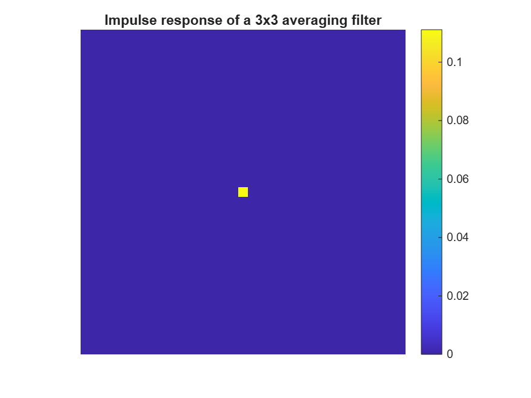
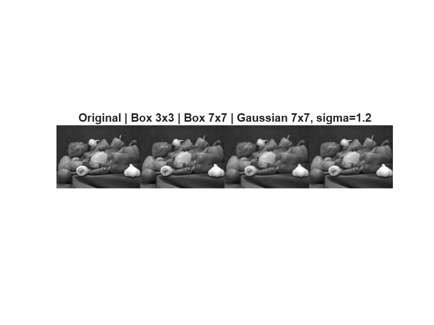
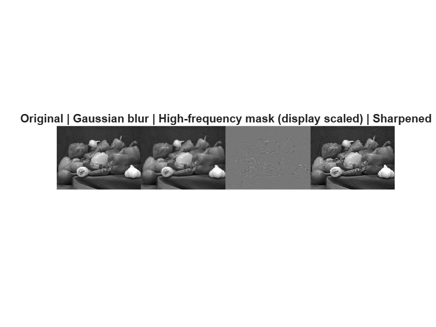
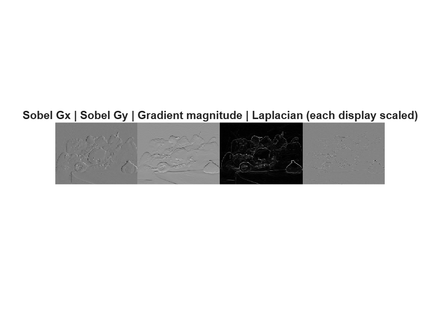
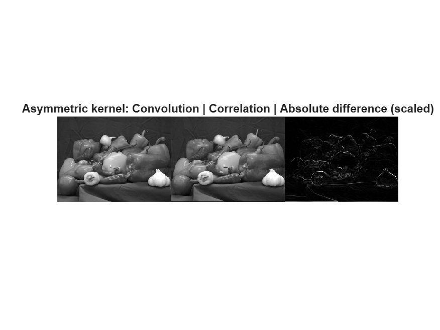
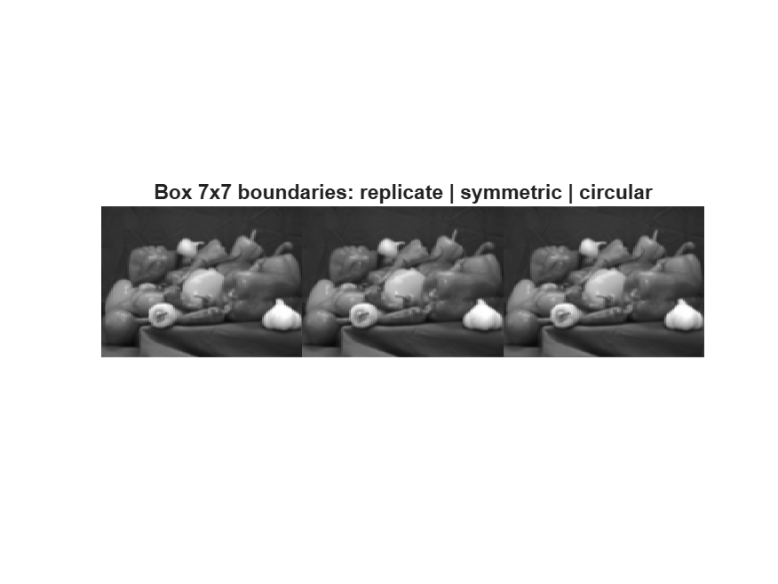
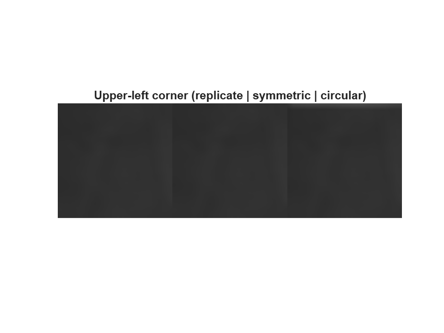

# Lab 2 — 2D Convolution & FIR Filters (Blur, Sharpen, Edges)

**Student:** Md Anwar Hossen

## 1. Objective

This lab investigates image filtering as a **two-dimensional discrete-signal operation**. A spatial filter kernel is the system's impulse response, \(h[m,n]\). The experiments demonstrate averaging and Gaussian smoothing, separable 2D filtering, unsharp-mask sharpening, edge detection with Sobel and Laplacian kernels, convolution versus correlation, and three ways of handling image boundaries.

## 2. Input image and experiment settings

| Setting | Value |
| --- | --- |
| Source image | `peppers.png` |
| Converted grayscale size | **384 × 512 pixels** |
| Averaging (box) kernels | 3 × 3 and 7 × 7 |
| Gaussian kernel | 7 × 7 with \(\sigma = 1.2\) |
| Sharpening gain | 1.0 |
| Laplacian `fspecial` parameter | 0.2 |
| Boundary comparison | `replicate`, `symmetric`, `circular` |

The script loads the image, converts it to double-precision grayscale, and saves figures and measurements to `results/`. Image values are in the range 0–1. Display-only scaling is explicitly indicated in the relevant figure captions.

## 3. Results and observations

### Section 1 — Delta image and impulse response

A 101 × 101 image was created with a single impulse of value 1 at position (51, 51). The impulse was convolved with the normalized 3 × 3 average kernel:

\[
h_{\mathrm{avg}}=\frac{1}{9}
\begin{bmatrix}1&1&1\\1&1&1\\1&1&1\end{bmatrix}.
\]

**Observed:** The output is zero except for a tiny bright square in the center. That square represents the 3 × 3 kernel, whose nine entries each have magnitude \(1/9\approx0.1111\). This confirms that convolving a discrete impulse with a finite impulse response returns the kernel itself, aligned with the impulse.

### Section 2 — Low-pass filtering: 3 × 3 box, 7 × 7 box, Gaussian

**Observed:** The original grayscale peppers image is the sharpest. The 3 × 3 box blur makes a modest change; the 7 × 7 box blur visibly softens outlines and fine texture more. The Gaussian blur also smooths texture while weighting neighboring pixels according to their distance from the center. In this particular comparison, its appearance differs from the equally sized 7 × 7 box blur because the weights are not uniform.

A Gaussian is often preferable to a large box kernel because its spatial weights vary smoothly and its ideal frequency response does not have the prominent sidelobes associated with a box kernel. This is a reason to consider Gaussian smoothing, not proof it is optimal for every application.

**Separability:** The 7 × 7 Gaussian was constructed as \(h=g^\mathsf{T}g\), where \(g\) is a 1 × 7 Gaussian vector. Direct 2D filtering and two consecutive 1D filtering passes were compared. MATLAB measured a maximum absolute difference of **4.4408920985 × 10⁻¹⁶**, which is consistent with floating-point rounding error.

For a direct, unoptimized 7 × 7 FIR convolution, there are **49 kernel multiplications per interior output pixel**. A separable implementation instead needs approximately **7 + 7 = 14**. This is **35 fewer multiplications**, or about **71.4% fewer** in that simplified arithmetic model. Actual MATLAB run-time differences may vary due to implementation details and memory overhead.

### Section 3 — Unsharp masking (sharpening)

The script makes a Gaussian-blurred image \(I_{\mathrm{blur}}\), subtracts it from the original image to form a signed detail mask, and adds that mask back with gain 1:

\[
M=I-I_{\mathrm{blur}},\qquad I_{\mathrm{sharp}}=\operatorname{clip}(I+M,0,1).
\]

**Observed:** The blurred version has softened edges. The high-frequency mask highlights changes around the peppers and other object boundaries. The sharpened image has more prominent local detail and edge contrast than the blurred version. The mask is scaled for display, but the *unscaled signed mask* is used by the actual sharpening calculation. A larger sharpening gain could amplify noise and create halos.

### Section 4 — Edge detection with Sobel and Laplacian

Sobel filters estimate horizontal and vertical changes in intensity, denoted \(G_x\) and \(G_y\). Their combined gradient magnitude is

\[
G=\sqrt{G_x^2+G_y^2}.
\]

**Observed:** The directional Sobel images respond to different edge orientations. The gradient magnitude image emphasizes the outlines of peppers and other objects irrespective of edge direction. The Laplacian highlights rapid second-order intensity changes and produces a different, fine-edged appearance. **Each panel is scaled separately for visualization**, so the displayed brightness is not a direct comparison of raw filter magnitudes.

### Section 5 — Convolution versus correlation

Correlation uses the kernel as supplied; convolution flips the kernel by 180° before applying it. For a **symmetric 3 × 3 box kernel**, flipping does not change the weights. The script compared `conv2(I,h_box3,'same')` with `imfilter(I,h_box3,'conv','same')`, obtaining a maximum absolute difference of **3.33066907388 × 10⁻¹⁶**, effectively zero at floating-point precision.

To make the distinction visible, the script also used an **asymmetric kernel** and compared `imfilter(...,'conv')` against `imfilter(...,'corr')`.

**Observed:** The two filtered images look broadly similar at normal viewing size, but the absolute-difference panel outlines places where their responses differ. The measured maximum absolute difference is **0.759477124183** (with the input scaled to the 0–1 grayscale range). This demonstrates why kernel flipping matters for asymmetric filters.

### Section 6 — Boundary handling

The script applied the 7 × 7 box filter with three border extensions:

- **Replicate:** Use the nearest existing edge pixel for points outside the image.
- **Symmetric:** Reflect image pixel values across the boundary.
- **Circular:** Wrap to pixels on the opposite side of the image.

**Observed:** The three full-image outputs appear very similar because the padding policy affects primarily pixels near the frame boundary. The magnified upper-left corner is relatively dark and low in detail, so differences remain subtle in this particular screenshot. Nevertheless, the three extensions use different assumed values outside the image, and a high-contrast boundary would make the differences easier to notice. `circular` padding is especially likely to create edge artifacts if opposite borders do not match.

## 4. MATLAB numerical measurements

The table below reproduces the results in [`results/lab2_measurements.txt`](results/lab2_measurements.txt).

| Quantity | Measured value | Meaning |
| --- | ---: | --- |
| Grayscale image dimensions | 384 × 512 | Height × width |
| Maximum difference, `conv2` vs `imfilter(...,'conv')`, symmetric box | 3.33066907388 × 10⁻¹⁶ | Numerically equivalent |
| Maximum difference, asymmetric convolution vs correlation | 0.759477124183 | Kernel reversal changes the output |
| Maximum difference, 2D Gaussian vs two 1D passes | 4.4408920985 × 10⁻¹⁶ | Separable implementations agree within rounding |
| Direct vs separable 7 × 7 multiplications | 49 vs 14 per interior output pixel | Simple operation-count comparison |

**Important:** The near-zero values are small floating-point residuals, not evidence of mathematical differences between the equivalent algorithms. No runtime benchmark was measured.

## 5. Reflection questions and answers

### 1) Why is Gaussian preferred over a large box low-pass filter?

Gaussian weights smoothly decrease with distance from the center, whereas a box filter gives every pixel in its window the same weight. The Gaussian has a smoother frequency response without box-filter sidelobes. In my blur comparison, both reduced fine detail, but the 7 × 7 box blur softened boundaries more broadly than the smaller 3 × 3 box blur. Gaussian smoothing is useful when we want a gradually weighted blur, though the best choice depends on image content and the task.

### 2) What does separability do for computational cost?

Separability replaces one 2D convolution with two 1D passes. A direct 7 × 7 convolution requires 49 multiplications per interior pixel in the simple model, but two 7-element passes use about 14. The results from my MATLAB run differ by only **4.4408920985 × 10⁻¹⁶**, so the separable version preserves the numerical result while requiring fewer arithmetic operations in principle.

### 3) How do boundary modes change corners and edges?

The modes assume different pixel values outside the image. Replicate extends the nearest border value, symmetric mirrors neighboring image content, and circular wraps the opposite edge. Thus the output differences are concentrated near edges and corners when a convolution window overlaps the boundary. In my peppers-image results, the overall pictures look almost the same, and the corner zoom shows only subtle changes because that region is fairly uniform.
