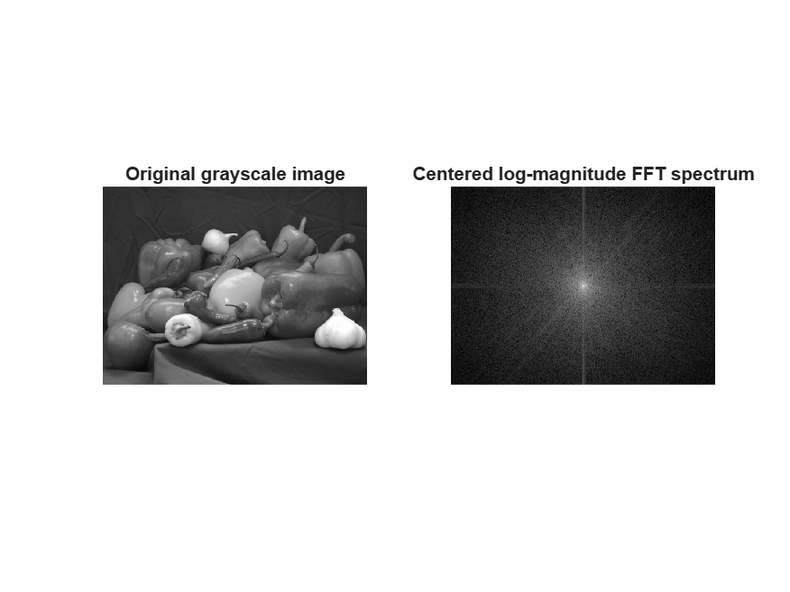
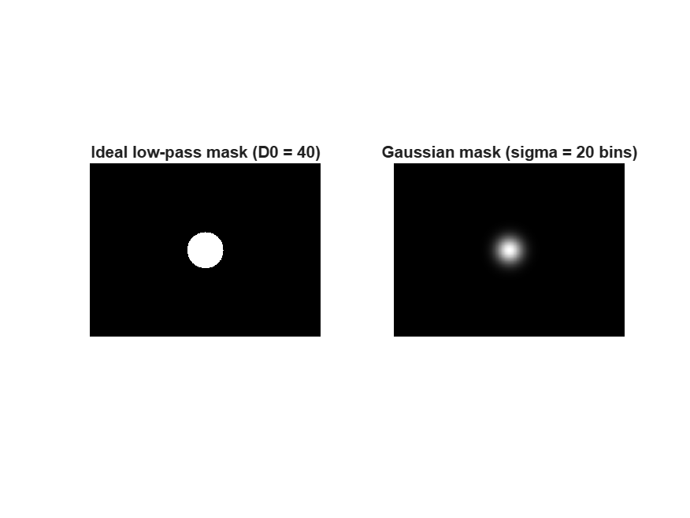
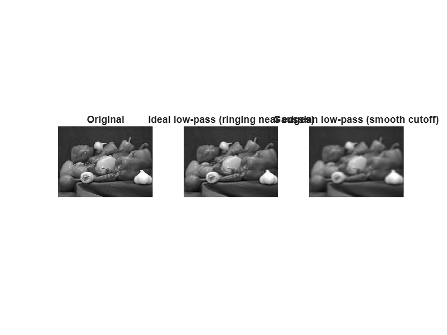
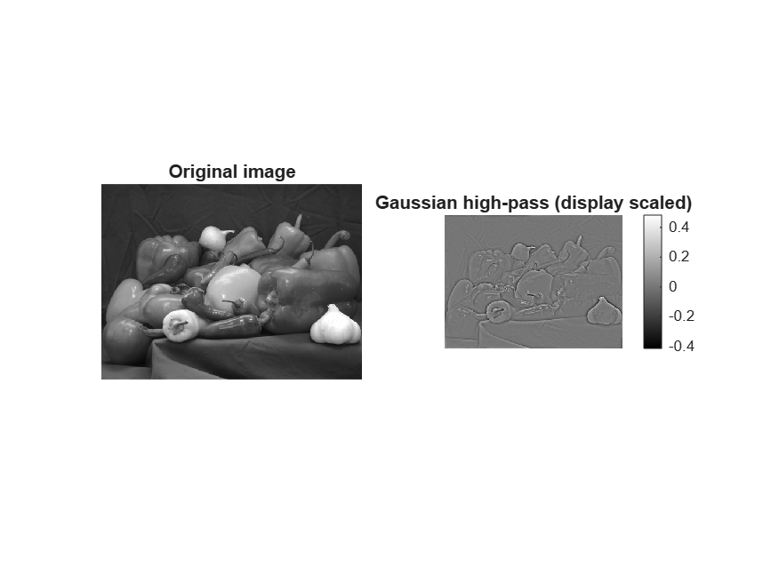
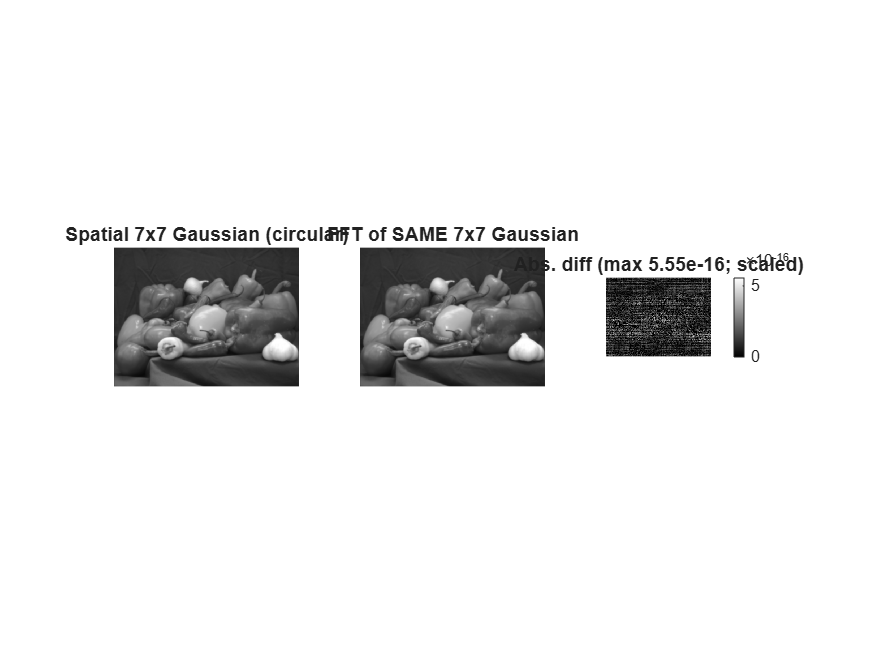

# Lab 3 — Frequency-Domain Filtering with `fft2`
 
**Student:** Md Anwar Hossen

## Overview and objective

This lab treats a grayscale image as a two-dimensional signal. I investigated its 2D Fourier spectrum; constructed ideal and Gaussian low-pass masks; applied low- and high-pass filters by multiplying in the frequency domain; and compared Gaussian filtering in the spatial and frequency domains. The results below describe the five figures produced in MATLAB and the numerical values reported in `results/lab3_measurements.txt`.


## Section 1 — Image magnitude spectrum (log scale)

The image FFT is computed with `fft2(I)`. `fftshift` rearranges the frequency coordinates so that the zero-frequency (DC) value lies in the center. The quantity `log(1 + abs(fftshift(fft2(I))))` compresses the display range and makes weaker frequency components easier to see alongside the strong low-frequency content.



**Observed result:** The left panel shows the peppers image in grayscale. The right panel shows a bright region around the center and weaker, textured frequency components farther away. The central brightness is consistent with substantial low-frequency image content, while the outward components correspond to finer spatial variation. Faint horizontal/vertical structures can also be seen in the spectrum.

## Section 2 — Ideal and Gaussian low-pass masks

The filter masks are built using distance `D` from the center of the frequency grid:

- **Ideal low-pass:** `H_ideal_LP = double(D <= 40)`. Frequencies inside the radius are passed, and frequencies outside it are rejected abruptly.
- **Gaussian low-pass:** `H_gauss_LP = exp(-D.^2/(2*20^2))`. The response decreases smoothly with distance from the origin.



**Observed result:** The ideal mask is a clearly bounded white disk on black, whereas the Gaussian mask is a bright central spot that fades gradually. Both concentrate on low spatial frequencies, but only the ideal mask has a hard cutoff.

## Section 3 — Filtering with ideal and Gaussian low-pass masks

Each mask is multiplied by the centered FFT. `ifftshift` then puts the result back in the ordering expected by `ifft2`, and the inverse transform reconstructs the filtered image.



**Observed result:** Both filtered images lose fine detail relative to the original. The ideal low-pass image retains some sharper transitions but shows slight edge halos/oscillations in high-contrast regions. The Gaussian low-pass image has visibly softer textures and smoother transitions, especially around the peppers and garlic. The two masks are **not matched in effective blur strength**, so this is a comparison of their responses as configured, not proof that one is universally better.

**Explanation:** A sharp ideal frequency cutoff creates a spatial impulse response with oscillating side lobes. The side lobes can cause bright/dark ringing around edges (a Gibbs-type effect). A smooth Gaussian frequency response avoids a sharp transition and tends to reduce such ringing, at the cost of blurring detail.

## Section 4 — Gaussian high-pass filtering

The high-pass mask is obtained from the low-pass complement, `H_gauss_HP = 1 - H_gauss_LP`. The inverse-transformed result retains spatial changes while suppressing most slowly varying image brightness.



**Observed result:** The output emphasizes outlines of the peppers, garlic, and other object boundaries. Large nearly uniform surfaces are subdued, whereas fine structures appear as light/dark lines. This result contains signed values and is displayed with adjusted intensity limits (`imshow(G_hp,[])`); the display scaling is **only for visualization** and should not be interpreted as the original image brightness.

## Section 5 — Gaussian spatial convolution versus FFT filtering

The original lab example compared two Gaussian filters with **different widths and units**, which cannot be expected to produce the same pixels. The corrected script uses one **identical discrete 7 × 7 Gaussian kernel (σ = 1.2 pixels)** in both methods, with circular boundary handling:

- **Spatial:** `imfilter(I, h_spatial, 'circular', 'conv')`
- **Frequency:** `real(ifft2(fft2(I) .* psf2otf(h_spatial,[M N])))`

The `psf2otf` function transforms and aligns the finite spatial kernel for the image-size FFT. Circular boundaries are essential to this like-for-like comparison: without sufficient padding, multiplication of equal-sized DFTs implements **circular convolution**.



**Observed result:** The two filtered images look indistinguishable. The third panel magnifies extremely small numerical differences for display, which does **not** mean the images differ visibly. The recorded calculations were:

```bash
Maximum absolute difference: 5.55111512312578e-16
RMSE of difference:         1.23757078276153e-16
```

These values are around floating-point rounding precision. They support the **2D convolution theorem** under the matching kernel and circular-boundary assumptions; they do not mean the outputs are bit-for-bit identical.

The Gaussian shown in this section is **not** the same as the analytic 20-bin Gaussian used for the low-pass illustration in Section 3.

## Section 6 — Reflection questions and answers

### 1. Why does ideal low-pass filtering cause ringing (Gibbs phenomenon)?

An ideal low-pass mask jumps immediately from 1 to 0 at its cutoff. This abrupt transition corresponds to a spatial impulse response with oscillations and sidelobes. When applied to a sharp image edge, those oscillations can create overshoots and undershoots that appear as alternating bright and dark halos. In the low-pass comparison image, small halos are visible near high-contrast edges. A Gaussian mask changes smoothly and usually reduces this effect.

### 2. What does `fftshift` do visually?

The ordinary `fft2` output places the zero-frequency component at the corner of the array. `fftshift` reorders the array so that zero frequency is centered; surrounding locations then represent increasing positive/negative spatial frequencies. This makes the spectrum easier to read and centered circular filters easier to build. It does not add or remove Fourier information.

### 3. When is frequency-domain filtering computationally preferable?

FFT filtering is often preferable for **large images with large, nonseparable convolution kernels**, or when a frequency-domain representation is already available. Direct convolution with an M × N image and a k × k kernel has roughly O(MNk²) work, whereas FFT-based convolution is typically about O(MN log(MN)) after accounting for padding and transforms. For small or separable filters, direct spatial filtering may be simpler and faster. This lab **did not benchmark runtimes**, so this is a theoretical comparison rather than a measured speedup.
