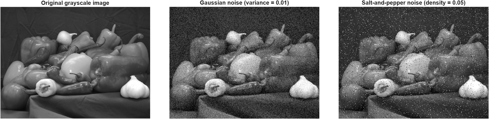
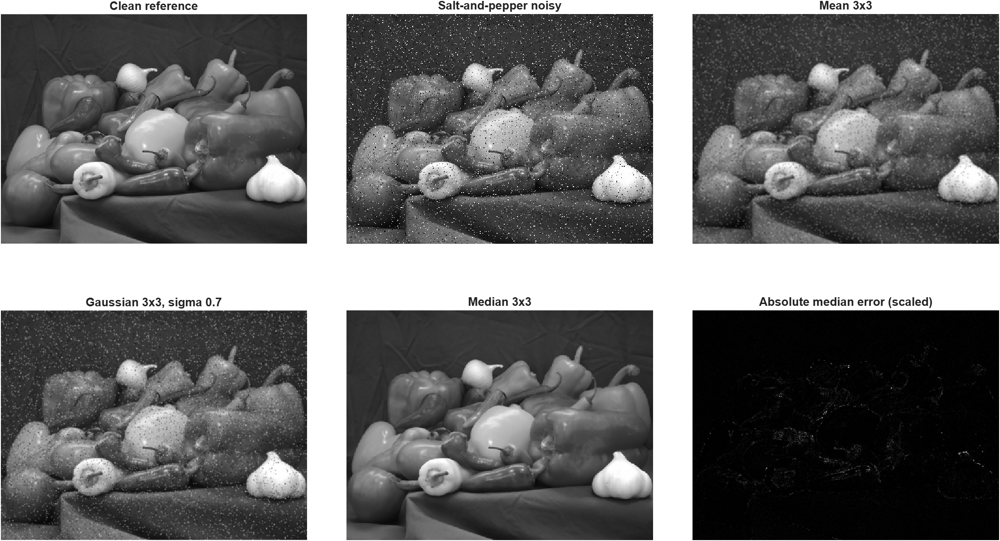
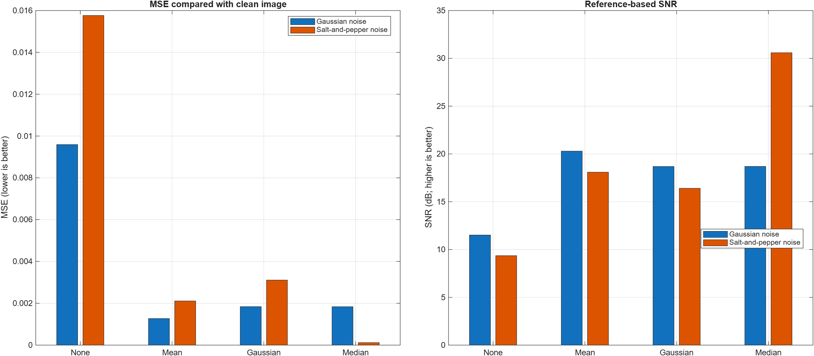
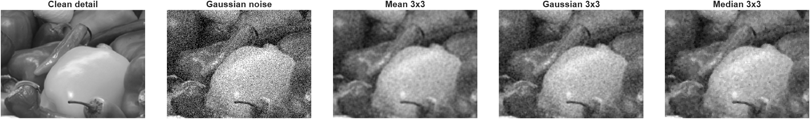

# Lab 4 — Noise and Filtering

**Student:** Md Anwar Hossen

##  Objective

This lab investigates the effect of **Gaussian noise** and **salt-and-pepper (impulse) noise** on a two-dimensional grayscale image. The same noisy images are filtered with **3×3 mean**, **3×3 Gaussian**, and **3×3 median** filters. I compare the resulting images visually and quantitatively using **mean-square error (MSE)** and **reference-based signal-to-noise ratio (SNR)** against the original clean image.

The goal is to determine which of these filters performs best for each noise type under the tested settings, while considering how filtering affects edges and image details.

## Section 1 — Add different noise types

**Observed result:** The clean grayscale image contains identifiable peppers, smooth background regions, and object boundaries. The **Gaussian-noisy image** has fine, grain-like intensity fluctuations throughout the image. The **salt-and-pepper image** has scattered bright-white and black pixels, especially visible in darker smooth areas. These are different noise patterns even though both reduce image quality.

Gaussian noise was added with variance 0.01. Salt-and-pepper noise was added with density 0.05, meaning approximately 5% of pixels are selected for impulse corruption.

##  Sections 2–4 — Compare denoising filters

###  Salt-and-pepper noise

**Observed result:** The **3×3 median filter** removes most of the isolated bright and dark noise pixels while keeping the pepper shapes and boundaries recognizable. By comparison, the mean filter and Gaussian filter reduce some noise but leave visible speckling; averaging can spread the effect of an impulse into neighboring pixels.

The final panel is the **absolute error after median filtering**, scaled for display. It highlights where the filtered image differs from the clean image; its display brightness is not itself the numerical MSE.

### Gaussian noise

**Observed result:** All three filters reduce some of the grainy fluctuations compared with the unfiltered Gaussian-noisy image. The 3×3 **mean filter** makes the image smoother and achieves the **lowest measured MSE** for this particular Gaussian-noise experiment. The Gaussian-weighted and median filters also reduce noise, but neither performs better than the mean filter according to the measurements.

The final panel shows the absolute error after Gaussian filtering, scaled for viewing. Image smoothing can also soften real edges and fine textures, so visual quality must be considered alongside numerical scores.

##  Section 5 — Measured MSE and SNR

For an estimated image `J` and clean reference image `I`, both having `M × N` pixels, the script calculates:

\[
\mathrm{MSE}(J,I)=\frac{1}{MN}\sum_{m=1}^{M}\sum_{n=1}^{N}(J[m,n]-I[m,n])^2.
\]

\[
\mathrm{SNR}_{\mathrm{ref}}=10\log_{10}\left(\frac{\operatorname{mean}(I^2)}{\mathrm{MSE}(J,I)}\right)\;\mathrm{dB}.
\]

**Lower MSE is better**, because it means less squared error relative to the clean image. **Higher reference-based SNR is better**, because it means less error relative to the reference-image power. This is **not PSNR**: it uses the average power of the actual clean image instead of the maximum pixel intensity.

### Actual values from MATLAB

| Method | Gaussian MSE ↓ | Salt-and-pepper MSE ↓ | Gaussian SNR ↑ | Salt-and-pepper SNR ↑ |
|---|---:|---:|---:|---:|
| No filter | 0.0095888 | 0.0157649 | 11.51 dB | 9.36 dB |
| **Mean 3×3** | **0.0012705** | 0.0021114 | **20.29 dB** | 18.09 dB |
| Gaussian 3×3 (σ = 0.7) | 0.0018403 | 0.0031090 | 18.68 dB | 16.41 dB |
| **Median 3×3** | 0.0018363 | **0.0001187** | 18.69 dB | **30.59 dB** |

**Gaussian noise:** The 3×3 mean filter had the lowest MSE (**0.0012705**) and highest SNR (**20.29 dB**). Relative to the original Gaussian-noise MSE, the improvement is:

\[
\frac{0.0095888-0.0012705}{0.0095888}\times100\%\approx\mathbf{86.75\%}\text{ reduction in MSE}.
\]

**Salt-and-pepper noise:** The 3×3 median filter had the lowest MSE (**0.0001187**) and highest SNR (**30.59 dB**). Relative to the original salt-and-pepper MSE, the improvement is:

\[
\frac{0.0157649-0.0001187}{0.0157649}\times100\%\approx\mathbf{99.25\%}\text{ reduction in MSE}.
\]

These percentages indicate reductions in **squared error**, not percentages of noisy pixels removed. The measured differences in this table come from the fixed-seed MATLAB run; the figures do not by themselves establish performance on all photographs.

## Section 6 — Detail preservation

This figure compares a **matching crop** of the clean image, the Gaussian-noisy image, and the mean, Gaussian, and median results. The unfiltered noisy crop contains many small intensity fluctuations. The filters suppress these fluctuations, making the smooth surfaces more uniform.

The comparison also demonstrates the trade-off between denoising and preserving genuine texture. Averaging filters combine nearby intensities, which can soften image boundaries. Median filtering is less sensitive to isolated extreme values, although it can still remove some small features or alter edges. The clearest-looking image is not automatically the one with the best MSE for every image.

## Answers to the three reflection questions

### Q1. Which noise is best removed by a median filter? Why?

The **salt-and-pepper noise** is best removed by the median filter in this lab. It consists of occasional extreme black or white pixels. The median takes the middle-ranked value from a local 3×3 neighborhood, making a single extreme pixel much less influential than it is under averaging. In my MATLAB measurements, salt-and-pepper MSE decreased from **0.0157649** without filtering to **0.0001187** with the median filter. The corresponding SNR rose from **9.36 dB** to **30.59 dB**. The comparison figure also shows far fewer visible noise dots after median filtering.

### Q2. Why does linear filtering blur edges more?

Linear mean and Gaussian filters compute weighted sums of neighboring pixel values. Near an edge, pixels on opposite sides have different intensities, and the weighted average mixes them together. This can make a sharp boundary look more gradual or blurred. The Gaussian filter weighs nearby pixels differently, but still averages across boundaries. Median filtering uses a ranking operation instead of a linear average, so it can preserve some boundaries better, especially in the presence of impulse noise. However, median filtering can also distort very fine image details.

### Q3. How could adaptive filters preserve detail?

An adaptive filter can change how strongly it smooths different parts of an image. For example, it could apply stronger denoising in relatively smooth regions and less denoising near detected edges. An **adaptive median filter** can change its neighborhood size based on suspected impulse noise. **Bilateral filtering** can combine spatial proximity with intensity similarity to reduce averaging across edges. These are potential improvements for future experiments; **adaptive filters were not tested in this lab**.