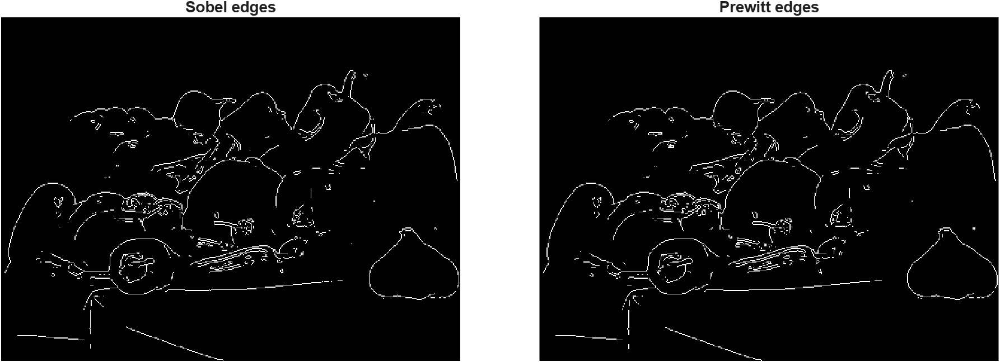
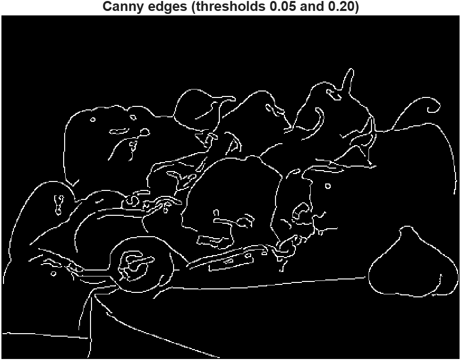
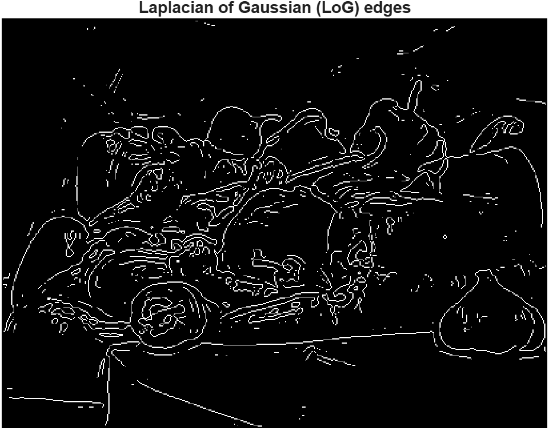
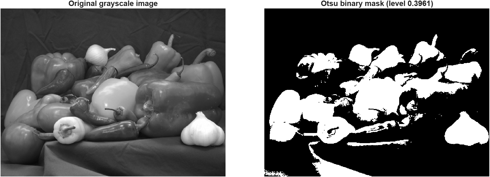
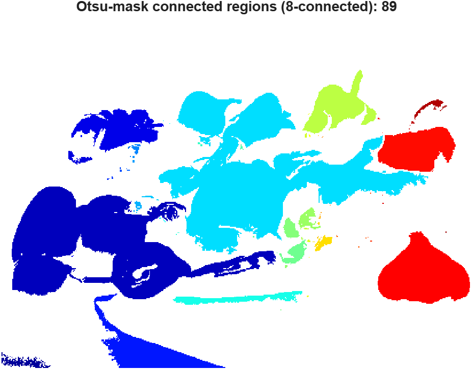

# Lab 5 — Edge Detection and Segmentation

**Input:** `peppers.png` converted to grayscale (384 × 512 pixels).  
**MATLAB code:** `Lab5_edge_detection_segmentation.m`

## 1. Sobel and Prewitt Edge Detection

Both methods detect intensity changes using image gradients. The results look similar, outlining the peppers and other objects. Sobel detected **4,757** edge pixels and Prewitt detected **4,740**.

## 2. Canny Edge Detection

Canny uses smoothing, non-maximum suppression, and two thresholds to produce thin, connected edges. With thresholds **0.05 and 0.20**, it detected **6,821** edge pixels. The main object outlines appear relatively clear and continuous.

## 3. Laplacian of Gaussian (LoG)

LoG smooths the image and detects zero crossings of the second-derivative response. It found **8,386** edge pixels, including more fine details and fragmented contours than the other methods.

## 4. Otsu Thresholding

Otsu's method automatically selects a threshold from the grayscale histogram. The calculated threshold was **0.3961**. The binary mask marks **53,972 pixels (27.45%)** as foreground. Bright areas are selected, but this does not separate every vegetable correctly.

## 5. Connected-Component Labeling

Using 8-connected component labeling, MATLAB identified **89 regions** in the Otsu mask. These are connected groups of foreground pixels, **not** 89 separate vegetables.

## 6. Reflections

**Which operator gives the thinnest, cleanest edges?**  
In these results, **Canny** gives the clearest thin and connected outlines. Sobel and Prewitt produce similar edges, while LoG shows more fine contours.

**Why does Canny outperform simple gradient filters?**  
Canny first reduces noise, then thins detected edges with non-maximum suppression. Its two-threshold hysteresis helps keep connected weak edges while rejecting isolated responses.

**How does Otsu relate to histogram-based thresholding?**  
Otsu selects a global threshold from the image intensity histogram by maximizing separation between two intensity classes. Here, it selected **0.3961** and divided the image into foreground and background based on brightness.
