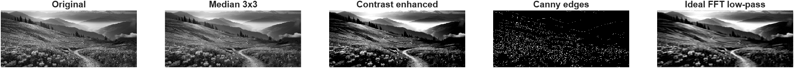
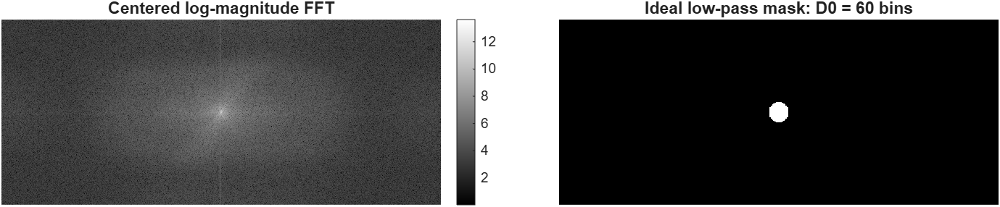

# Lab 6 — Mini Project: Image Processing Pipeline

## Image and problem

**Image:** `mountain-landscape.jpg` (mountain landscape with flowers and a winding path).

**Problem:** Examine how noise reduction, contrast enhancement, edge detection, and frequency-domain filtering change the visibility of landscape details.

## Processing pipeline and results

1. **Grayscale conversion:** Converts the color photograph into a 2D intensity signal for image processing.
2. **Median filtering (3×3):** A nonlinear spatial filter replaces each pixel with its neighborhood median. The resulting image looks similar to the original, with some fine texture smoothed.
3. **Contrast enhancement (`imadjust`, [0.2, 0.8]):** Remaps pixel intensities to increase contrast. The enhanced image shows darker shadows and brighter highlights; some tonal detail is lost in extreme areas.
4. **Canny edge detection (thresholds 0.1 and 0.25):** Finds intensity transitions. The edge map highlights mountain ridges, the winding path, trees, and many fine flower/grass boundaries.
5. **Ideal frequency-domain low-pass filtering (radius 60 FFT bins):** Uses `fft2`, a circular frequency mask, and `ifft2` to suppress high spatial frequencies. Large landscape shapes remain, but flowers and textures are noticeably blurred.

The centered FFT places low spatial frequencies near the middle. The circular mask passes frequencies inside the radius and rejects frequencies outside it.

## DSP operations

- **Median filter:** Nonlinear neighborhood operation for smoothing isolated intensity variations.
- **Contrast adjustment:** Pointwise intensity remapping (image enhancement).
- **Canny:** Gradient-based edge detection, responding to changes in image intensity.
- **FFT low-pass:** Frequency-domain multiplication; retaining low frequencies smooths the spatial image.

## Improvements and limitations

The input image has no known added noise, so noise-removal accuracy cannot be measured from this experiment. Median filtering can remove fine details as well as noise. Fixed contrast and Canny thresholds may not suit every image. The ideal low-pass filter removes useful textures and can create ringing near sharp boundaries; FFT filtering also assumes periodic boundaries. A Gaussian low-pass and adjustable thresholds could reduce these limitations.
