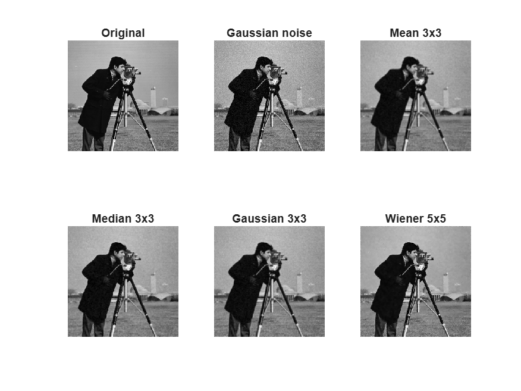
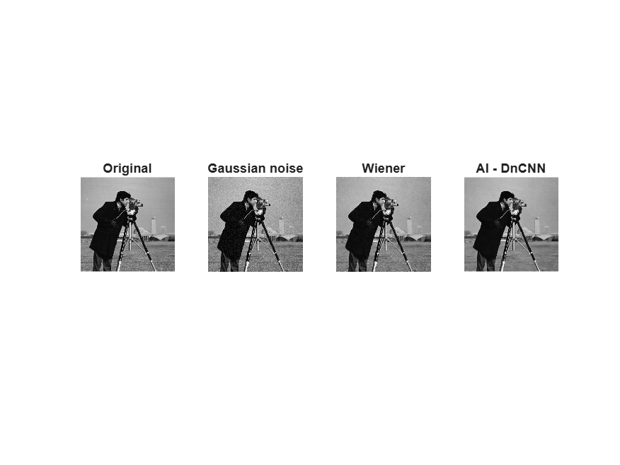
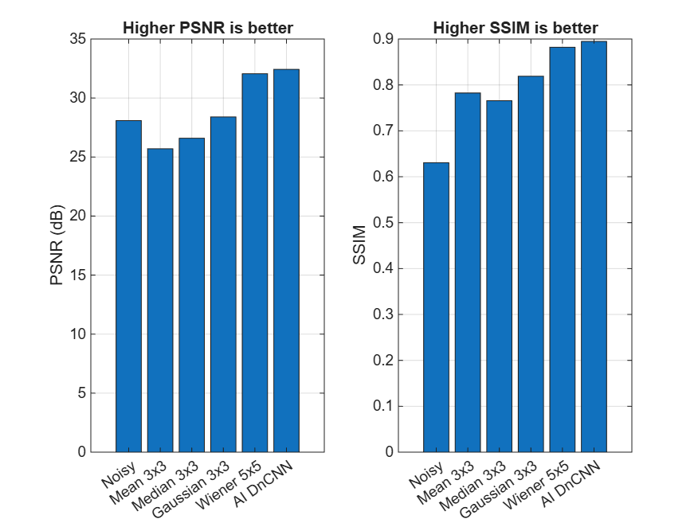

# Lab 7 — Traditional vs AI Gaussian Filters

## 1. Gaussian noise

The grayscale `cameraman.tif` image was corrupted with Gaussian noise (standard deviation **0.04**, variance **0.0016**). The noisy image contains visible grain.

## 2. Traditional filtering

The **mean 3×3**, **median 3×3**, **Gaussian 3×3**, and **Wiener 5×5** filters were applied to the same noisy image. The mean filter blurred details, while the Gaussian and median filters reduced some noise. The adaptive Wiener filter gave the lowest MSE among the traditional methods tested.

## 3. AI filtering

MATLAB's pretrained **DnCNN** successfully denoised the same image. In this experiment, it achieved slightly better image-quality metrics than the Wiener filter.

## 4. MSE, PSNR and SSIM results

Lower **MSE** indicates less pixel error; higher **PSNR** indicates less error relative to the image's intensity range; higher **SSIM** indicates greater structural similarity.

| Method | MSE | PSNR (dB) | SSIM |
|---|---:|---:|---:|
| Gaussian noise (unfiltered) | 0.0015524 | 28.0900 | 0.63052 |
| Mean 3×3 | 0.0026903 | 25.7020 | 0.78241 |
| Median 3×3 | 0.0021890 | 26.5976 | 0.76563 |
| Gaussian 3×3 | 0.0014453 | 28.4004 | 0.81900 |
| Wiener 5×5 | 0.0006224 | 32.0593 | 0.88198 |
| AI DnCNN | **0.0005718** | **32.4275** | **0.89482** |

## 5. Conclusion

For this image and noise level, **DnCNN performed best** on MSE, PSNR, and SSIM. **Wiener 5×5** was the best traditional filter. Mean and median filtering increased SSIM compared with the noisy image but also increased MSE, showing that different quality metrics can rank results differently.
