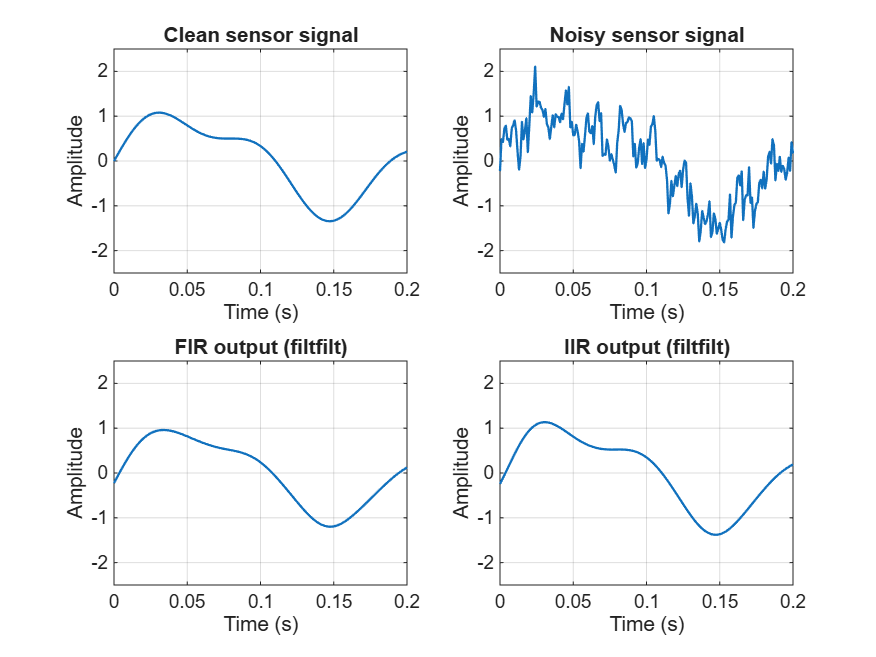
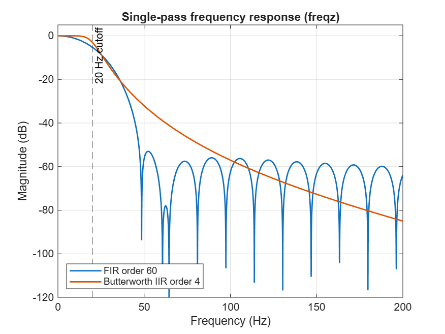
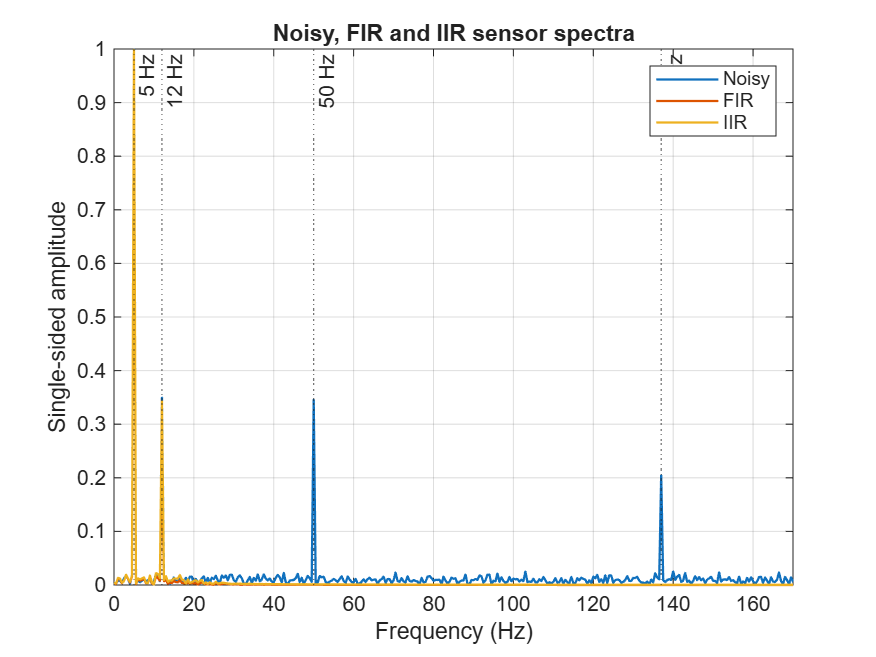
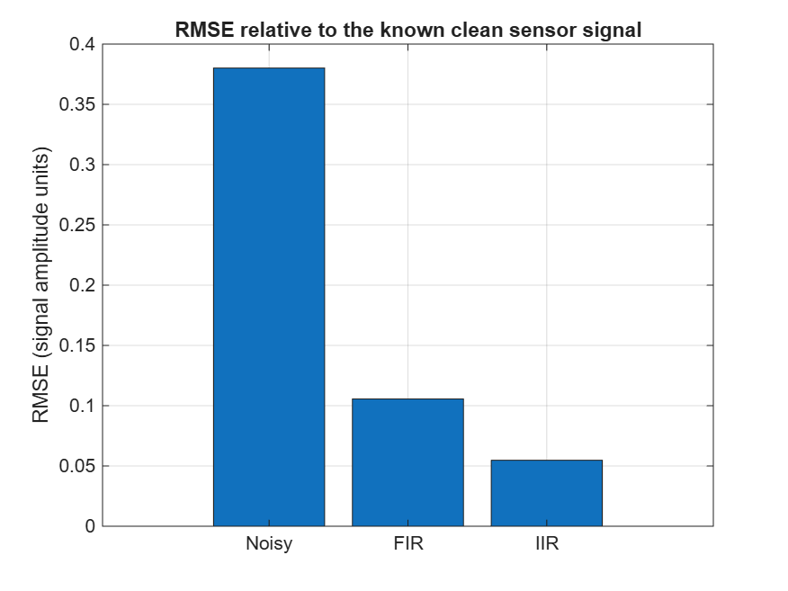
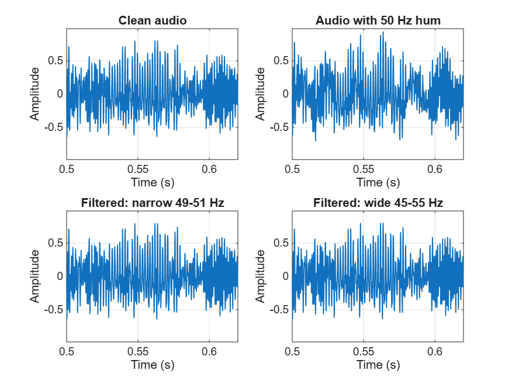
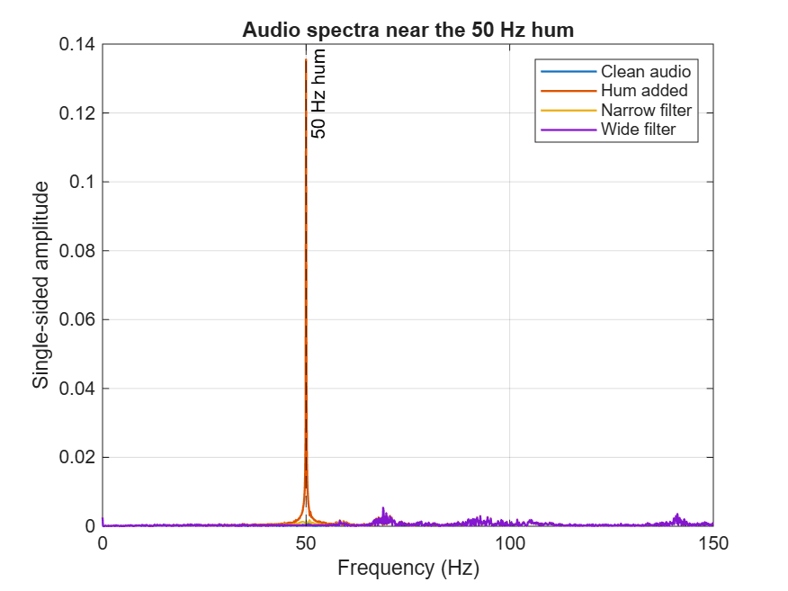
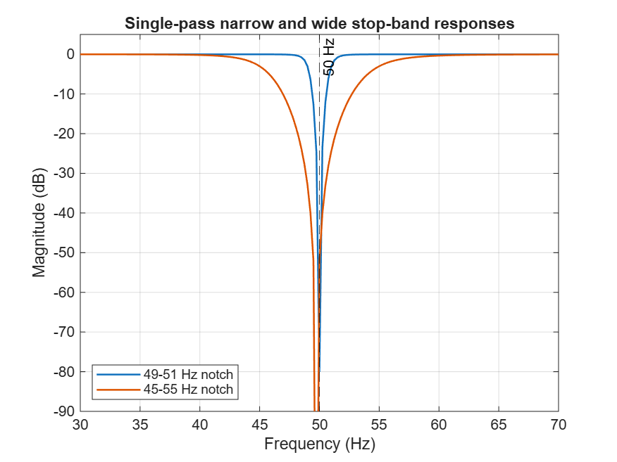

# Lecture 6 — Practical Digital Filtering in MATLAB

- **Part A — Sensor signal filtering:** Compare a 60th-order FIR low-pass filter with a 4th-order Butterworth IIR low-pass filter, both designed using a **20 Hz cutoff**. Evaluate the filtered waveforms, 

## 1. Part A — Filtering a sensor signal

### 1.1 Signal setup

The experiment uses a **2-second** sampled signal at **1,000 Hz**. The known clean signal contains the wanted **5 Hz** and **12 Hz** components:

\[
x_{\mathrm{clean}}(t)=\sin(2\pi 5t)+0.35\sin(2\pi 12t).
\]

The signal is then corrupted by **50 Hz** and **137 Hz** sinusoidal interference and random noise:

\[
x_{\mathrm{noisy}}(t)=x_{\mathrm{clean}}(t)
 +0.35\sin(2\pi 50t)+0.20\sin(2\pi 137t)
 +0.25\,\eta(t),
\]

where \(\eta(t)\) is generated with `randn` using the fixed random seed. The exact signal-generation procedure is in [`lecture6_filtering.m`](lecture6_filtering.m).

### 1.2 Filters compared

| Property | FIR low-pass | IIR low-pass |
| --- | --- | --- |
| Design | `fir1(60, 20/(1000/2), 'low')` | `butter(4, 20/(1000/2), 'low')` |
| Nominal cutoff | 20 Hz | 20 Hz |
| Design order | 60 | 4 |
| FIR taps | 61 | Not applicable |
| Application to recording | `filtfilt(bFIR,1,x)` | `filtfilt(bIIR,aIIR,x)` |

The cutoff is above the wanted **5 Hz** and **12 Hz** components, but below the unwanted **50 Hz** and **137 Hz** interference. This choice assumes the useful sensor information lies mainly below **20 Hz**.

**Important response distinction:** The plotted `freqz` curves are the **single-pass** magnitude responses of the filter designs. The actual processing uses `filtfilt`, which applies each filter forward and backward. Its overall magnitude response is approximately the **squared single-pass magnitude** and it eliminates ordinary phase delay in this offline setup. Therefore, a `freqz` curve must not be described as the exact net `filtfilt` response.

### 1.3 Measured sensor results

The error metric is:

\[
\mathrm{RMSE}=\sqrt{\frac{1}{N}\sum_{n=0}^{N-1}
(\hat{x}[n]-x_{\mathrm{clean}}[n])^2}.
\]

| Signal | Measured RMSE | Change from noisy RMSE |
| --- | ---: | ---: |
| Unfiltered noisy sensor | 0.38011668 | Baseline |
| FIR output | 0.10558962 | 72.22% lower |
| IIR output | **0.05477381** | **85.59% lower** |

For example, the relative reduction for the IIR output is:

\[
100\left(1-\frac{0.05477381}{0.38011668}\right)=85.59\%.
\]

**Interpretation:** Both filters substantially reduce the error compared with the unfiltered sensor recording. In this particular controlled test, the **4th-order IIR output has the lowest RMSE**. This is evidence for the selected 20 Hz filtering task, not proof that an IIR filter is always better than an FIR filter.

### 1.4 Figures and observations

**Sensor time-domain comparison:** The noisy waveform contains faster fluctuations that are much less prominent in the FIR and IIR outputs. Both filtered waveforms resemble the known clean signal more closely.

**Filter frequency responses:** Both designs attenuate higher frequencies, but their single-pass responses have different transition shapes and stop-band behavior.

**Sensor amplitude spectra:** The wanted components around **5 Hz** and **12 Hz** remain visible after filtering; the unwanted peaks around **50 Hz** and **137 Hz** are substantially reduced in the filtered spectra.

**RMSE comparison:** The IIR output is closest to the known clean signal according to the measured RMSE in this experiment.

## 2. Part B — Removing 50 Hz hum from audio

### 2.1 Audio setup and filters

The source is MATLAB's built-in `handel` example, loaded using `load handel`. The provided run reports an audio sampling rate of **8,192 Hz**. A controlled sinusoidal interference of nominal amplitude **0.15** is added at **50 Hz**:

\[
x_{\mathrm{hum}}(t)=x_{\mathrm{clean}}(t)+0.15\sin(2\pi 50t).
\]

Two Butterworth band-stop designs are compared:

| Design | MATLAB call | Stop-band range |
| --- | --- | --- |
| Narrow notch | `butter(2,[49 51]/(FsAudio/2),'stop')` | 49–51 Hz |
| Wide notch | `butter(2,[45 55]/(FsAudio/2),'stop')` | 45–55 Hz |

Both are applied with `filtfilt`. In MATLAB, the band-stop filter returned by `butter(2, ..., 'stop')` has fourth-order transfer-function coefficients, because the low-pass prototype order is doubled for the band-stop transformation.

### 2.2 How 50 Hz attenuation was measured

Because the script knows the injected hum waveform, it **filters that hum separately** and estimates its 50 Hz sinusoidal component by projecting onto a complex exponential:

\[
A_{50}=\frac{2}{N}\left|\sum_{n=0}^{N-1}
 h[n]e^{-j2\pi(50)n/F_s}\right|.
\]

The attenuation is then reported as:

\[
\mathrm{Attenuation}_{50}=20\log_{10}\left(\frac{A_{\mathrm{after}}}{A_{\mathrm{before}}}\right)\ \mathrm{dB}.
\]

These measurements represent the **residual of the deliberately injected 50 Hz hum**, rather than all of the natural audio content near 50 Hz. Their values also reflect the finite recording and `filtfilt` boundary behavior.

### 2.3 Measured audio results

| Measurement | Narrow 49–51 Hz | Wide 45–55 Hz |
| --- | ---: | ---: |
| Injected 50 Hz amplitude before filtering | 0.14999673 | 0.14999673 |
| Residual injected 50 Hz amplitude | 0.00092800 | **0.00017200** |
| Measured 50 Hz amplitude change | −44.17 dB | **−58.81 dB** |
| RMSE against original clean audio | 0.00526181 | **0.00331942** |

**Interpretation:** The wider stop-band reduces the exact injected hum further in this experiment and also gives a lower sample-based RMSE against the known clean audio. That **does not establish which version sounds better**: perceptual quality requires listening, and broader rejection can suppress nearby useful low-frequency content.

### 2.4 Figures and observations

**Waveforms:** The hum-added and filtered recordings have similar-looking short waveform segments; visual similarity alone cannot measure audible quality.

**Audio spectra:** Adding hum produces a prominent peak near **50 Hz**. Both filters strongly reduce that component.

**Notch responses:** The wider **45–55 Hz** design attenuates a greater surrounding frequency range than the **49–51 Hz** design. The figure displays **single-pass** responses, not the total `filtfilt` response.

## 3. Answers to the five report questions

### Q1. Why is a 20 Hz low-pass reasonable, and what does it assume?

The clean sensor signal in this experiment is made of 5 Hz and 12 Hz components, both below 20 Hz. The known interference components are 50 Hz and 137 Hz, above the chosen cutoff. A 20 Hz low-pass therefore attempts to retain the desired slow variation while suppressing faster disturbances. **The assumption** is that important sensor information does not need frequencies above 20 Hz; that assumption may not hold for a different sensor or a fast transient event.

### Q2. Which filter gives the better result for the chosen requirements? Give at least two types of evidence.

For the chosen requirement of **minimizing RMSE against the known clean sensor signal while retaining the 5 Hz and 12 Hz content**, the **4th-order Butterworth IIR** gives the better result in this run.

1. **Numerical evidence:** IIR RMSE = **0.05477381**, versus FIR RMSE = **0.10558962** and unfiltered RMSE = **0.38011668**.
2. **Visual/spectral evidence:** The IIR time-domain output follows the clean waveform closely, and the filtered spectrum strongly reduces the 50 Hz and 137 Hz interference while retaining the wanted lower-frequency components.

This comparison does not establish that the IIR is best for every requirement. Constraints such as guaranteed stability margins, exact phase handling, implementation complexity, and different interference profiles may lead to another choice.

### Q3. How would the implementation change for live, low-latency filtering?

The current `filtfilt` workflow is **offline and non-causal**: it needs future samples to perform backward filtering, so it cannot be used unchanged for a truly live stream. A real-time implementation would process samples in the forward direction with a causal filtering method, maintain filter state between processing blocks, and measure end-to-end latency. It would also need to consider the phase delay and transient behavior that `filtfilt` avoided offline. For a low-latency implementation, a lower-order IIR could be tested, provided stability, accuracy, and practical timing requirements are satisfied.

### Q4. Why is a narrow stop-band appropriate for a steady 50 Hz hum? What if the hum drifts?

A steady hum concentrated at 50 Hz can be removed with a narrow notch, limiting the amount of nearby useful sound removed. If the hum frequency moves away from 50 Hz, a very narrow rejection band may no longer suppress it adequately. Possible solutions include a somewhat wider notch, a notch whose center frequency tracks the interference, or a more adaptive approach. The experiment's 45–55 Hz comparison demonstrates the wider-band trade-off: better attenuation of the specific injected hum in this run, with a broader range of neighbouring frequencies also being attenuated.

### Q5. Give one limitation and one improvement for a real measurement system.

**Limitation:** The sensor data and added audio hum are controlled examples with known clean references; real environments may contain drifting interference, nonstationary noise, missing clean reference signals, and sensor-specific signal details. The reported RMSE and attenuation numbers therefore do not automatically generalize to field measurements.

**Improvement:** Evaluate the proposed filters on representative real recordings and changing interference conditions, using both quantitative measures and application-specific tests. For a live sensor, also test a causal implementation and measure delay and resource use. For audio, carry out a blinded, equal-gain listening comparison before selecting the final notch width.

