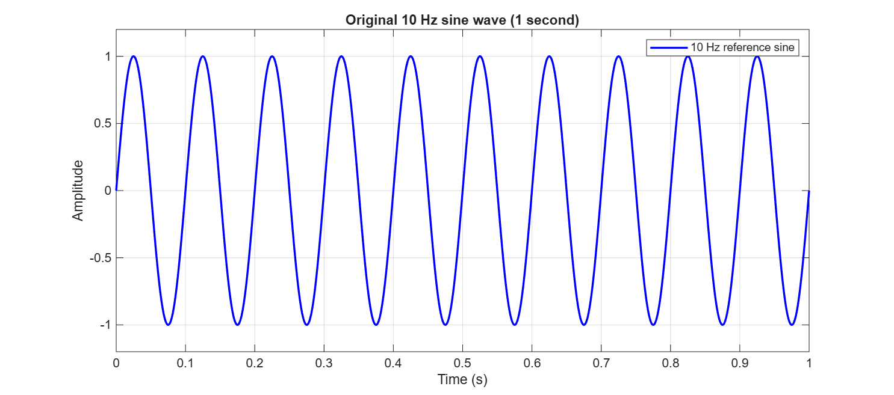
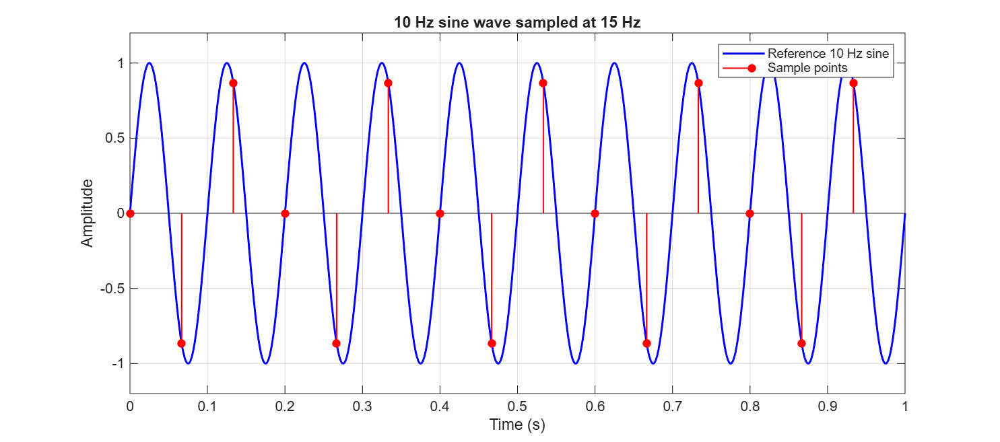
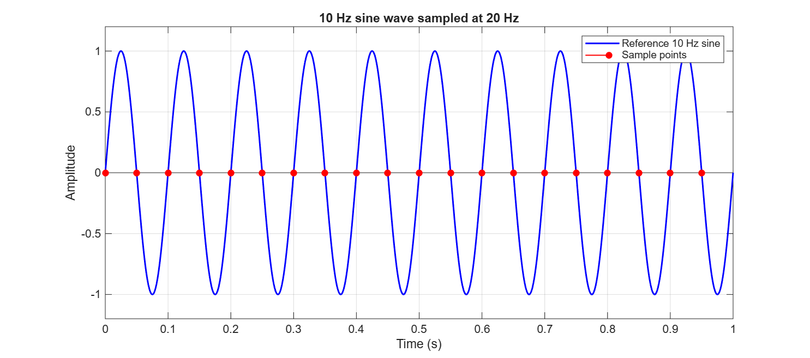
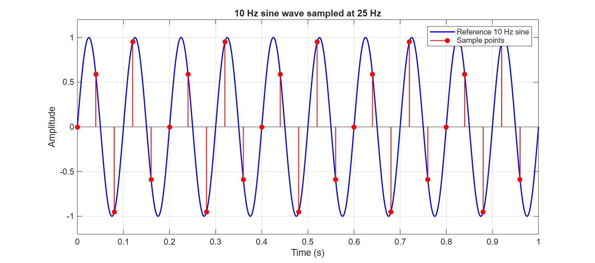
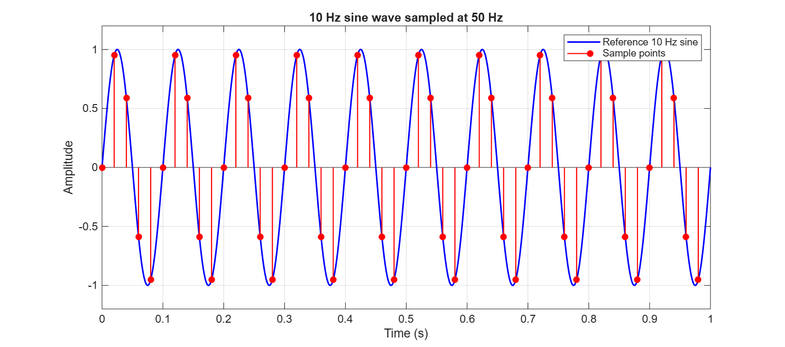
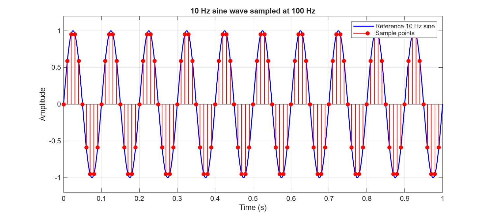

# Lecture 02 — Sampling and Aliasing Investigation Using MATLAB

**Student:** Md Anwar Hossen

## 1. Objective

This experiment investigates how different sampling frequencies affect the representation of a continuous-time signal. A 10 Hz sine wave is generated for one second and sampled at **15, 20, 25, 50, and 100 Hz**. The plots are compared to explain the Nyquist sampling theorem, show aliasing, and select a practical sampling frequency for the simplified sensor-monitoring scenario in the assignment.

## 2. Results: Original signal and sampling comparisons

### 2.1 Original signal

**Observation:** The reference plot contains **10 full cycles in one second**, consistent with a signal frequency of 10 Hz. The waveform varies between approximately −1 and +1.

### 2.2 Sampling at 15 Hz

**Observation:** Only 1.5 samples are taken per original cycle. This rate is **below** the 20 Hz Nyquist boundary. The red sample values do lie on the reference sine, but the *sequence of discrete samples* is also compatible with a **5 Hz sine wave of opposite sign**. This is aliasing; the samples do not uniquely identify the original 10 Hz frequency.

The alias calculation is

\[
f_{\mathrm{alias}}=|f_s-f|=|15-10|=5\ \text{Hz}.
\]

More exactly, at the sample indices,

\[
\sin\!\left(2\pi\frac{10}{15}n\right)
=-\sin\!\left(2\pi\frac{5}{15}n\right).
\]

### 2.3 Sampling at 20 Hz

**Observation:** All the red sample values appear on the zero line even though the blue reference wave oscillates between −1 and +1. The sampling rate is exactly twice the 10 Hz signal frequency, but this particular zero-phase sine is sampled only at its zero crossings:

\[
x[n]=\sin\!\left(2\pi\frac{10}{20}n\right)=\sin(\pi n)=0.
\]

This shows the limitation of sampling **exactly at** the Nyquist boundary. The waveform cannot be reconstructed uniquely from these all-zero samples.

### 2.4 Sampling at 25 Hz

**Observation:** There are 2.5 samples per cycle and the sample values agree with the 10 Hz reference waveform. The sampling rate is now **strictly greater than** 20 Hz, so the 10 Hz component is not aliased for an ideal band-limited signal. The points still look relatively sparse in a time-domain plot.

### 2.5 Sampling at 50 Hz

**Observation:** There are five samples per cycle. The red points show positive and negative portions of the 10 Hz wave more clearly than at 25 Hz. This rate provides more detail for viewing the waveform, at the cost of more samples per second.

### 2.6 Sampling at 100 Hz

**Observation:** There are ten samples per cycle. This is the densest sampling shown in the assignment and the sampled points visibly follow the reference curve closely. The one-second recording contains 100 samples.

### 2.7 Summary table

| Sampling rate | Sample period | Samples in 1 second | Samples per 10 Hz cycle | Observation |
|---|---:|---:|---:|---|
| 15 Hz | 66.67 ms | 15 | 1.5 | Aliased: apparent 5 Hz frequency |
| 20 Hz | 50.00 ms | 20 | 2 | All samples zero for this signal phase |
| 25 Hz | 40.00 ms | 25 | 2.5 | Above Nyquist; relatively sparse samples |
| 50 Hz | 20.00 ms | 50 | 5 | Clearer sampled representation |
| 100 Hz | 10.00 ms | 100 | 10 | Densest sampling in the comparison |

These values are calculated from the script parameters and are consistent with the six supplied figures. They are not the result of a separate frequency-estimation or reconstruction algorithm.

## 3. Nyquist Analysis

### 3.1 Highest frequency and minimum theoretical sampling rate

The original test signal is a **10 Hz sine wave**, so the highest frequency in the signal is:

\[
f_{\max}=10\ \text{Hz}.
\]

According to the Nyquist sampling theorem, the sampling rate must be **strictly greater than twice** the highest frequency for unambiguous ideal reconstruction of a band-limited signal. The *Nyquist rate* (the boundary value) is calculated as:

\[
f_{s,\text{Nyquist}}=2f_{\max}=2\times10=\boxed{20\ \text{Hz}}.
\]

**Answer to Task 3:** The calculated Nyquist sampling rate is **20 Hz**. For this experiment, choose **more than 20 Hz** to avoid the exact-boundary problem illustrated in the 20 Hz plot.

### 3.2 Which test frequencies satisfy the sampling condition?

| Tested sampling frequency | Comparison with 20 Hz | Conclusion |
|---|---|---|
| 15 Hz | Below the Nyquist rate | **Does not satisfy** the condition: the sampled 10 Hz sine aliases to an apparent 5 Hz component |
| 20 Hz | Exactly the Nyquist rate | **Boundary case**, not sufficient for unambiguous recovery of this zero-phase sine |
| 25 Hz | Strictly above 20 Hz | **Satisfies** the ideal sampling condition for this 10 Hz test |
| 50 Hz | Strictly above 20 Hz | **Satisfies** the condition; 5 samples per cycle |
| 100 Hz | Strictly above 20 Hz | **Satisfies** the condition; 10 samples per cycle |

### 3.3 Why does the 20 Hz plot have only zero samples?

At 20 Hz sampling, the sample instants are \(t_n=n/20\). Substituting them into the 10 Hz sine:

\[
x[n]=\sin(2\pi\cdot10\cdot n/20)=\sin(\pi n)=0,\qquad n=0,1,2,\ldots
\]

Therefore, **every red sample in `sampling_20Hz.png` is zero**, although the continuous-time waveform has an amplitude of 1. With these samples alone, the original sine cannot be recovered. This is a special failure at the exact Nyquist boundary, **not evidence that the original signal has zero amplitude**.

### 3.4 Is sampling exactly at the Nyquist rate recommended in practice?

**No.** Sampling exactly at 20 Hz provides no margin for phase-dependent boundary cases or changes in the signal's frequency content. For the 10 Hz classroom test, **50 Hz** (5 samples per cycle) or **100 Hz** (10 samples per cycle) gives a clearer sampled waveform. For an actual vibration sensor, choose a rate after identifying the highest frequency of interest and allowing for an anti-aliasing filter and real-world constraints.

## 4. Aliasing discussion

Aliasing occurs when different continuous-time frequencies produce indistinguishable sampled sequences. In this experiment, 15 Hz sampling is too low for a 10 Hz signal: the resulting sequence can be interpreted as a 5 Hz sine wave with reversed sign. At 20 Hz, the samples all lie at zero crossings, showing the special limitation of sampling exactly on the Nyquist boundary. The 25 Hz, 50 Hz, and 100 Hz cases exceed that boundary and retain a unique 10 Hz component under the ideal band-limited assumptions. The plots also show that using more samples per cycle makes the waveform easier to see. However, a higher rate increases storage, communication, and processing needs. For an actual machine, the maximum frequency of useful vibration should be measured or specified first, and an analog anti-aliasing filter should be fitted before sampling. A sampling rate that works for this simple 10 Hz test may not work for a machine with higher-frequency vibration components.

## 5. Engineering recommendation

**Recommended sampling frequency for the assignment's 10 Hz test: 100 Hz.** It gives **10 samples per cycle**, clearly displays the waveform, and provides a factor-of-five margin over the nominal 20 Hz Nyquist rate. A 50 Hz rate also represents this ideal 10 Hz signal correctly with fewer samples and may be adequate when data volume matters. The correct rate for real industrial machinery depends on the **highest frequency that needs to be measured**, sensor characteristics, filter transition band, and processing/storage constraints. It must not be selected solely from the 10 Hz test signal.

