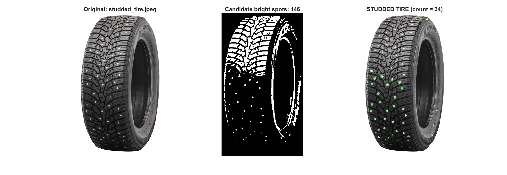
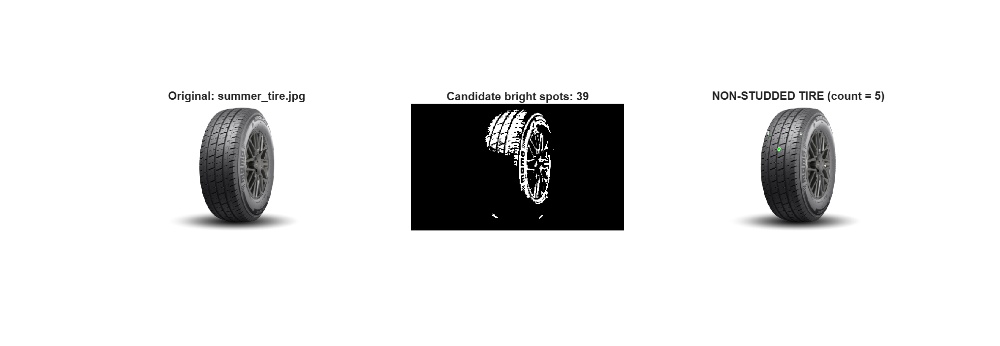

# Tire Stud Detector — MATLAB

## Goal
Detect possible metal studs in two tire images using grayscale preprocessing, image masking, morphology, and connected-component analysis.

## Method
1. Load `studded_tire.jpeg` and `summer_tire.jpg` and resize each to 50%.
2. Convert the images to grayscale and isolate the dark tire region with thresholding, hole filling, and morphological operations.
3. Find small bright regions inside the tire mask using local contrast and intensity thresholds.
4. Use `bwconncomp` and `regionprops` to keep small, approximately round candidates (area 4–120 pixels, circularity ≥ 0.60, eccentricity ≤ 0.85).
5. Classify a tire as **STUDDED TIRE** when more than 10 candidates pass the filters; otherwise classify it as **NON-STUDDED TIRE**.

## Results

| Image | Bright candidates | Accepted round components | Classification |
|---|---:|---:|---|
| `studded_tire.jpeg` | 146 | 34 | **STUDDED TIRE** |
| `summer_tire.jpg` | 39 | 5 | **NON-STUDDED TIRE** |

### Studded tire

The script retained 34 small, round bright components, exceeding the decision threshold of 10.

### Non-studded tire

The script retained 5 small, round bright components, below the decision threshold.

## Limitation
Bright tread details and reflections can be mistaken for studs. These are **heuristic candidate counts**, not manually verified counts of actual metal studs. The thresholds were tested on these two images only; more images would be needed to evaluate reliability.
