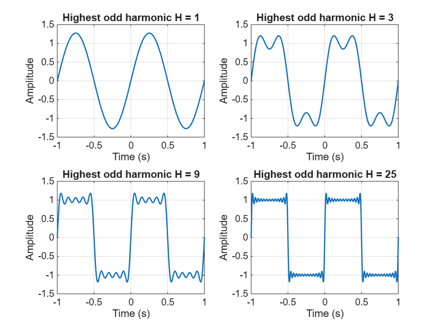
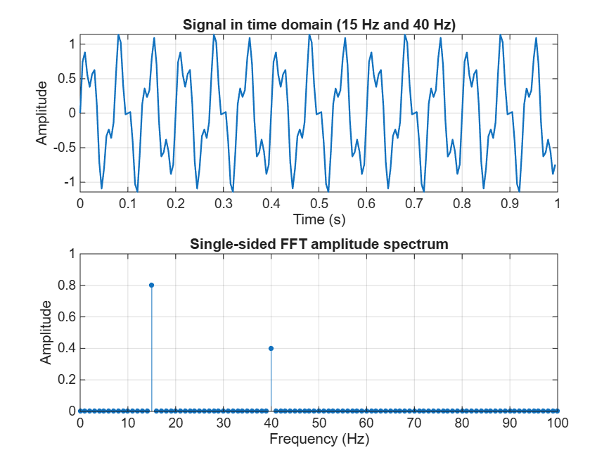
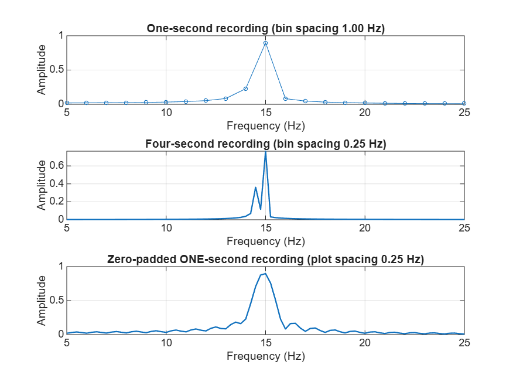
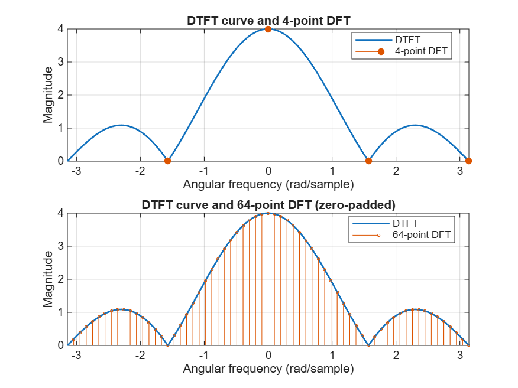

# Lecture 5 — Fourier Assignment

## Exercise 1 — Build a Square Wave from Harmonics

The approximation adds **odd** sine harmonics:

$$
x_H(t)=\frac{4}{\pi}\sum_{k=1,3,5,\ldots,H}\frac{\sin(2\pi kt)}{k}.
$$

### Prediction

Theory suggests that using more odd harmonics will make the waveform look more like a square wave: flatter positive and negative sections, and steeper transitions. Small ripples should remain near sudden changes.

### Results and explanation

The plot compares the *highest odd harmonic* included, **H = 1, 3, 9 and 25**:

- **H = 1:** A smooth sine wave, with no flat top or bottom.
- **H = 3:** The top and bottom begin to flatten, while some ripples appear.
- **H = 9:** The flat sections and transitions are more distinct.
- **H = 25:** The approximation is closest to a square wave, with sharper edges and smaller-scale ripples around the transitions.

In the last two plots, the overshoot and oscillations near the sharp jumps are visible. This is the **Gibbs phenomenon**. Adding harmonics narrows the region of oscillation but does not entirely remove the overshoot at a discontinuity.



## Exercise 2 — Find Two Frequencies with the FFT

The MATLAB signal is

$$
x(t)=0.8\sin(2\pi\cdot15t)+0.4\sin(2\pi\cdot40t).
$$

The sampling frequency is **200 Hz** and the recording duration is **1 second**.

### Calculation

The number of samples is

$$
N=f_sT=200\times1=200.
$$

The frequency-bin spacing is

$$
\Delta f=\frac{f_s}{N}=\frac{200}{200}=\boxed{1\text{ Hz}}.
$$

### Prediction and results

I would expect two peaks, one at 15 Hz and another at 40 Hz, because the time-domain signal contains those two sine waves. Both frequencies fall exactly on the 1 Hz FFT grid.

| Component | Expected frequency | Peak frequency visible in plot | Expected amplitude | Amplitude visible in plot |
|---|---:|---:|---:|---:|
| First sine wave | 15 Hz | About **15 Hz** | 0.8 | About **0.8** |
| Second sine wave | 40 Hz | About **40 Hz** | 0.4 | About **0.4** |

The single-sided FFT spectrum contains two narrow peaks at the expected frequencies. The 15 Hz peak is about twice as tall as the 40 Hz peak, matching their amplitudes in the original signal. The time-domain plot looks more complicated because the two sine waves are added together.



## Exercise 3 — Investigate Spectral Leakage

For this exercise, the last digit of my student number is **8**. Using the formula from the assignment,

$$
f_2=13.2+0.17d=13.2+0.17(8)=\boxed{14.56\text{ Hz}}.
$$

The signal is therefore

$$
x(t)=0.8\sin(2\pi\cdot15t)+0.4\sin(2\pi\cdot14.56t).
$$

The two frequencies differ by **0.44 Hz**.

### Prediction

With only one second of data, the FFT bins are spaced 1 Hz apart. The 14.56 Hz component is between the 14 Hz and 15 Hz bins, so its energy should spread into nearby bins. It is also close to the 15 Hz component, making the two peaks difficult to distinguish. A four-second recording should show greater separation. Zero-padding should make the curve appear smoother, but should not provide the resolution of a genuinely longer recording.

### Bin-spacing calculations

| Method | Measured samples | FFT length | Frequency-point spacing |
|---|---:|---:|---:|
| One-second recording | 200 | 200 | $200/200=\mathbf{1.00\text{ Hz}}$ |
| Four-second recording | 800 | 800 | $200/800=\mathbf{0.25\text{ Hz}}$ |
| One-second recording, zero-padded | 200 | 800 | $200/800=\mathbf{0.25\text{ Hz}}$ |

### Results and explanation

- **One-second recording:** The plot shows a dominant peak near 15 Hz, but energy is spread around it. At 1 Hz bin spacing, the 14.56 Hz and 15 Hz components are too close to appear as two clearly separated peaks.
- **Four-second recording:** The plot has narrower spectral features near 14.5–15 Hz, and the two components become more distinguishable. The spacing is 0.25 Hz because more **actual samples** were recorded. There is still some leakage because 14.56 Hz does not fall exactly on a 0.25 Hz bin.
- **Zero-padded one-second recording:** The frequency curve becomes smoother and uses frequency points 0.25 Hz apart, but the peak remains broad. Zero-padding does not add observations or separate the two tones as effectively as recording four seconds of data.

**Conclusion:** More recorded data improves the ability to distinguish close frequencies. Zero-padding only samples the same one-second spectrum at more plotted frequencies; it does not add new signal information.



## Exercise 4 — Compare the DTFT and DFT

The sequence is

$$
x[n]=[1,1,1,1],\quad n=0,1,2,3.
$$

Its DTFT is

$$
X(e^{j\omega})=1+e^{-j\omega}+e^{-j2\omega}+e^{-j3\omega}.
$$

### Comparing the plotted results

The **DTFT** is a continuous function of angular frequency, so it appears as a smooth curve in the plot. The **4-point DFT** samples that curve at only four equally spaced frequencies. In MATLAB's normal FFT ordering,

```matlab
fft([1 1 1 1],4)
% [4 0 0 0]
```

The DFT magnitude is 4 at zero angular frequency and 0 at the other three four-point DFT bins. The first subplot therefore shows very few frequency samples.

The **64-point FFT** produces many more points along the same DTFT curve. This is why the second subplot follows the continuous-frequency shape much more closely.

### What happens with `fft(x,64)`?

`fft(x,64)` appends **60 zeros** to the original four samples before computing the DFT. It returns 64 frequency samples instead of 4, but **does not add new observed signal samples**. The increased number of points makes the existing frequency response easier to see.

### Where is the DTFT magnitude zero?

In the plotted interval from $-\pi$ to $\pi$, the theoretical magnitude zeros are at

$$
\boxed{\omega=-\pi,\;-\frac{\pi}{2},\;\frac{\pi}{2},\;\pi}.
$$

These zero locations correspond to the places where the blue DTFT curve meets the horizontal axis in the plot. A plotted grid may approach rather than sample an exact zero.


